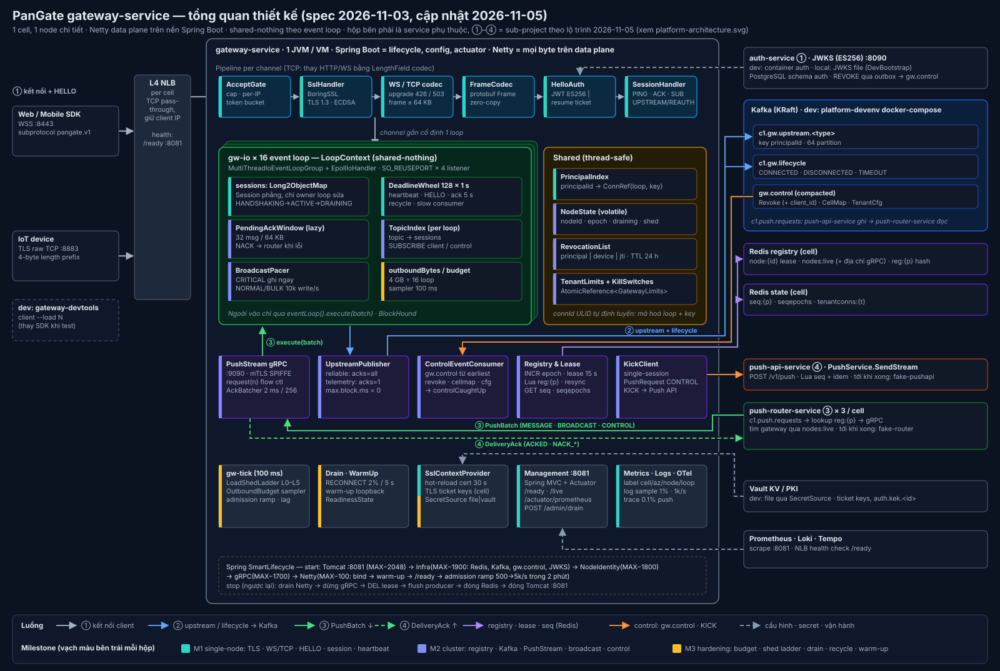

# gateway-service — Design Spec

- **Ngày:** 2026-11-03
- **Trạng thái:** Draft, chờ duyệt
- **Nguồn kiến trúc:** *Netty Gateway — 10M Active Connections* (Nov 2, 2026, @Kuu Kuu), gọi tắt là "tài liệu gốc". Mục số trong ngoặc, ví dụ (§4.1), là mục của tài liệu gốc.
- **Phạm vi:** `gateway-service` (data plane Netty trên nền Spring Boot) cùng base project tối thiểu để nó build, chạy và test được: `platform-parent`, `platform-contracts`, `platform-spring-starter`, `gateway-devtools`, `platform-devenv`.



---

## 0. Mục tiêu, tiêu chí thành công, phạm vi

**Mục tiêu.** Hiện thực gateway-service đúng kiến trúc của tài liệu gốc:
- Giữ kết nối WSS/TCP dài hạn, xác thực bằng frame `HELLO` (JWT hoặc resume ticket).
- Upstream đẩy vào Kafka; downstream nhận qua gRPC `PushStream` từ Push Router.
- Registry Redis xác định hợp lệ theo epoch của node.
- Bảo vệ node bằng admission, outbound budget và load-shedding ladder; drain và recycle kết nối an toàn.

Mục tiêu sizing: ~278k kết nối/node ở trạng thái thường, trần 500k, hard cap 700k (§2).

**Tiêu chí thành công của spec.** Kỹ sư hoặc coding agent có thể hiện thực theo từng milestone (§12 của spec) mà không phải đoán về module, class, contract, cấu hình, hành vi lỗi hay cách test.

**Trong phạm vi:**
- Base project đặt trong repo `K2IOT/PanGate`, mỗi thư mục là một Maven project độc lập, giữ tinh thần polyrepo của §13.
- Toàn bộ gateway-service, chia thành M1 (single-node), M2 (cluster) và M3 (hardening).
- Công cụ dev thay thế các service chưa tồn tại: JWT issuer, fake Push Router, fake Push API, client mẫu.

**Ngoài phạm vi:**
- push-router-service, push-api-service và các platform service khác (§3.2). Spec chỉ định nghĩa contract mà gateway dùng với chúng.
- Helm, Terraform, Argo; MQTT listener; multi-region.
- Load test 700k/node và 10M; các bài này thuộc repo `load-test`.

**Nguyên tắc bất biến** (từ tài liệu gốc):
1. Event loop không bao giờ block, không tạo timer riêng cho từng kết nối và không gọi đồng bộ tới service ở xa (§4).
2. Kết nối đang mở phải sống sót khi bất kỳ dependency nào lỗi; chỉ handshake mới và push downstream được phép suy giảm (§8).
3. Gateway mỏng: không chứa domain logic, không lưu message bền vững (§1, §13.7).
4. Push API là con đường duy nhất xuống client, kể cả KICK (§3.2, ADR-007).

---

## 1. Lựa chọn kỹ thuật

| Hạng mục | Chọn | Ghi chú |
|---|---|---|
| Ngôn ngữ / framework | Java 21, Spring Boot 3.5.16 (`platform-parent` kế thừa `spring-boot-starter-parent`, ghi đè `netty.version=4.2.20.Final`) | Tài liệu gốc yêu cầu 3.x. Chưa lên Boot 4 |
| Netty | 4.2.20.Final (tcnative 2.0.85.Final theo netty-bom), `MultiThreadIoEventLoopGroup` + `EpollIoHandler`; NIO fallback chỉ để phòng khi không có epoll; local (Ubuntu), dev và prod đều chạy epoll | API 4.2 thay `EpollEventLoopGroup` đã deprecated |
| TLS | `netty-tcnative-boringssl-static`, TLS 1.3, cert ECDSA P-256 | Không dùng JDK `SSLEngine` (§2) |
| gRPC | `grpc-netty-shaded`, event loop group riêng, port 9090 | Tách hẳn khỏi data plane |
| Redis | Lettuce 6.x: `RedisClusterClient` ở staging và prod, `RedisClient` standalone ở local và dev; chọn bằng `gateway.redis.topology`; một kết nối multiplexed cho mỗi master | §3.1, §9.1 |
| Kafka | `kafka-clients` thuần, không dùng spring-kafka trên hot path | Kiểm soát `buffer.memory`, `acks`, `max.block.ms` |
| Collections | fastutil (`Long2ObjectOpenHashMap`, `Object2ObjectOpenHashMap`, `ObjectArrayList`) | §4 |
| Management | Spring MVC + embedded Tomcat (`spring-boot-starter-web`) + Actuator, `server.port=8081`; Tomcat giới hạn `threads.max=8`, `min-spare=2`, `max-connections=200`, `accept-count=50` | Tomcat chỉ phục vụ cổng quản trị, không nằm trên data path (đúng §4 tài liệu gốc). Không dùng WebFlux: Spring Boot 3.5 pin Reactor Netty 1.2 cho Netty 4.1, xung đột với Netty 4.2 trên data plane |
| Metrics / trace | Micrometer → Prometheus; OpenTelemetry | §9 |
| Proto | `protobuf-maven-plugin`; `buf lint` + `buf breaking` trong CI | §3.4 |
| CLI devtools | picocli | |
| Build | Maven, mỗi thư mục một `pom.xml`, `Makefile` ở gốc repo | §13 |
| Image | Jib, base distroless Java 21; có từ M1 vì compose dev cần | §7.1 |
| Build wrapper | Maven Wrapper (`mvnw`) ở gốc repo, dùng `./mvnw -f <module>` | Không bắt buộc cài Maven |

---

## 2. Cấu trúc repo và module base

```
PanGate/
├── Makefile                  # make bootstrap: build/install theo thứ tự parent → contracts → starter → devtools → gateway
├── platform-parent/          # packaging=pom: dependencyManagement (BOM) + pluginManagement
├── platform-contracts/       # proto/pangate/v1/*.proto → contracts-java.jar
├── platform-spring-starter/  # cross-cutting tối thiểu cho gateway
├── gateway-service/          # data plane
├── gateway-devtools/         # CLI picocli: issuer, fake-router, fake-pushapi, client
├── platform-devenv/          # docker-compose cho môi trường dev (§2.4, §9.1)
├── mvnw, .mvn/               # Maven Wrapper dùng chung
└── docs/
    ├── superpowers/specs/    # spec này và sơ đồ
    └── adr/                  # ADR (xem §13 của spec)
```

**Quy tắc chung**
- Không có pom aggregator. Các module chỉ phụ thuộc nhau qua artifact đã `mvn install` (local) hoặc publish lên GitHub Packages (CI, sau M3).
- `platform-parent` pin chính xác version của mọi dependency bên ngoài. Enforcer bật: `requireJavaVersion 21`, `banDuplicateClasses`, `bannedDependencies` (gateway-service không được kéo `spring-boot-starter-webflux` hay `io.projectreactor.netty:*`).
- Artifact nội bộ dùng `0.1.0-SNAPSHOT` cho tới bản release đầu tiên ở cuối M3; từ đó áp dụng quy tắc "không SNAPSHOT trên main" (§13.7).
- `pluginManagement` gồm: compiler (release 21), surefire (unit), failsafe (`src/it/java`), jacoco, spotless (google-java-format), jib.

### 2.1 platform-contracts

`proto/pangate/v1/` chỉ chứa những contract mà gateway chạm tới:

| File | Nội dung |
|---|---|
| `frame.proto` | `Frame` envelope (§3.3), `FrameType`, `DeliveryClass`, các payload `Hello`, `Connected`, `Ack`, `Reauth`, `Reconnect`, `ErrorInfo`, `Subscribe` (payload lỗi đặt tên `ErrorInfo` để không trùng `java.lang.Error` trong code Java) |
| `router.proto` | `service PushStream { rpc Stream(stream PushBatch) returns (stream DeliveryAck); }`, `PushItem`, `ControlOp`, `AckItem` |
| `lifecycle.proto` | `ConnectionEvent` (§3.2) |
| `control.proto` | `ControlEvent { Revoke, CellMap, TenantCfg }` (§3.2) |
| `upstream.proto` | `UpstreamRecord` |
| `push.proto` | `PushRequest` (có kind `CONTROL`), `service PushService { rpc SendStream(stream PushRequest) returns (stream PushResponse); }`. Gateway chỉ dùng để gửi KICK |

Mọi thay đổi đều phải additive; `buf breaking` so với `main` chạy trong CI.

### 2.2 platform-spring-starter (tối giản)

Chỉ những gì gateway cần (YAGNI):
- `observability/`: Micrometer common tags `cell`, `az`, `node`, `service` lấy từ properties `pangate.*`.
- `kafka/`: `PangateHeaders` ghi và đọc header `traceparent`, `tenant-id`, `cell-id`, `content-type: application/x-protobuf; schema=pangate.v1.<Message>`.
- `logging/`: Logback `TurboFilter` hoặc converter redact token, và `PrincipalHasher` (HMAC-SHA256 với key lấy từ `SecretSource`).
- `secrets/`: SPI `SecretSource { byte[] get(String name); void watch(String name, Consumer<byte[]>); }` với hai bản cài đặt `FileSecretSource` (đọc thư mục, kiểm 30 s) và `VaultSecretSource` (KV v2). Chọn bằng `pangate.secrets.source=file|vault`.

### 2.3 gateway-devtools (một jar picocli)

| Subcommand | Chức năng |
|---|---|
| `issuer` | Sinh hoặc nạp cặp key ES256; HTTP `GET /.well-known/jwks.json`; `POST /tokens {tenant, principal, device, topics[], ttlSec}` → connect JWT |
| `token` | Ký connect JWT offline từ file private key ES256 (không cần chạy issuer), in ra stdout |
| `client` | Client WS hoặc TCP: HELLO bằng JWT hoặc ticket, PING định kỳ, in ra PUSH, tự ACK, gửi UPSTREAM, lưu và dùng lại resume ticket. Tùy chọn `--load N --ramp R` mở N kết nối idle |
| `fake-router` | gRPC client tới `:9090`: gửi `PushBatch` unicast (theo `connId`), broadcast hoặc control; in ra `DeliveryAck`; có chế độ tải `--rate` |
| `fake-pushapi` | gRPC server `PushService.SendStream`: nhận KICK của gateway, chuyển thành `PushItem CONTROL` rồi gửi qua `fake-router` |

### 2.4 platform-devenv

Một file `docker-compose.yml` dùng chung cho cả hai môi trường (§9.1), chia bằng compose profile. Mọi image đều pin version, không dùng `latest`.

| Service | Compose profile | Image | Cấu hình chính | Healthcheck |
|---|---|---|---|---|
| `kafka` | (mặc định) | `apache/kafka:3.9.1` | KRaft, 1 broker; hai listener: `INTERNAL://kafka:29092` cho container, `EXTERNAL://localhost:9092` cho JVM chạy trên máy (IDE) | `kafka-topics.sh --bootstrap-server kafka:29092 --list` |
| `kafka-init` | (mặc định) | cùng image | Tạo topic với `--if-not-exists`: `c1.gw.lifecycle` (32 partition), `c1.gw.upstream.{telemetry,cmd,cmd_result,read,sdk.metrics}` (64), `gw.control` (8, compact) | Exit 0 |
| `redis` | (mặc định) | `redis:7.4.2` | Standalone, port `6379` expose ra `localhost`; dùng chung cho registry và state (prefix key không trùng nhau) | `redis-cli ping` |
| `issuer` | `app` | `pangate/gateway-devtools:dev` (Jib) | `issuer --port 8090 --key /dev-secrets/es256.pem` | `GET /.well-known/jwks.json` |
| `fake-pushapi` | `app` | `pangate/gateway-devtools:dev` | `fake-pushapi --port 9443` (nhận KICK) | gRPC health |
| `gateway` | `app` | `pangate/gateway-service:dev` (Jib) | Profile `dev`; `depends_on` với `service_healthy` (và `service_completed_successfully` cho `kafka-init`); ports 8443, 8883, 9090, 8081 | `GET :8081/ready` |
| `devtools` | `tools` | `pangate/gateway-devtools:dev` | Chạy theo lệnh: `docker compose run --rm devtools smoke` | — |

- `make infra-up` chỉ bật nhóm mặc định (Kafka, Redis) và expose ra `localhost` để chạy gateway từ IDE (môi trường local).
- `make up` bật thêm profile `app` (môi trường dev, toàn bộ trong Docker).
- Volume `dev-secrets` dùng chung giữa `issuer` và `gateway`. Secret do `DevBootstrap` sinh ra lần đầu (§9.1); `issuer` sinh `es256.pem` nếu chưa có. Ở dev, hai container này chạy `user: "0"` để ghi được vào named volume (image distroless mặc định chạy nonroot).
- Image distroless không có shell hay curl. Healthcheck gọi class Java nhỏ có sẵn trong image: `java -cp @/app/jib-classpath-file com.pangate.gateway.tools.HealthCheck http://127.0.0.1:8081/ready` (devtools có lệnh `health` tương đương).
- Redis chạy **standalone** ở local và dev, cluster chỉ ở staging và prod. Mọi Lua script trong spec chỉ đụng một key nên chạy giống hệt nhau trên hai mode. Lý do không dùng cluster ở đây: Redis Cluster trong Docker announce IP container, JVM trên máy không kết nối được.
- PostgreSQL và ScyllaDB **không** có trong devenv của gateway vì gateway không dùng database. Chúng sẽ được thêm khi xây các platform service (§3.2 tài liệu gốc).

---

## 3. Kiến trúc nội bộ gateway-service

### 3.1 Package (`com.pangate.gateway`)

| Package | Thành phần |
|---|---|
| `config` | `GatewayProperties` (`@ConfigurationProperties("gateway")`), `GatewayLimits` (record immutable, hot-reload qua `AtomicReference`), `RedisConfig`, `KafkaConfig`, `GrpcConfig` |
| `server` | `NettyGatewayServer` (SmartLifecycle), `IoGroups`, `ListenerFactory` |
| `loop` | `LoopContext`, `LoopRegistry`, `DeadlineWheel` |
| `pipeline` | `WsChannelInitializer`, `TcpChannelInitializer`, `AcceptGate`, `UpgradeGuard`, `WsBinaryAdapter`, `HelloAuthHandler`, `SessionHandler`, `SseHandler` (M3), `UpstreamHttpHandler` (M3) |
| `session` | `Session`, `SessionState`, `PendingAckWindow`, `PrincipalIndex`, `ConnRef`, `ConnId` |
| `protocol` | `FrameCodec`, `PreEncodedFrame`, `FrameFactory`, `CloseCode` |
| `auth` | `JwksCache`, `JwtVerifier`, `ResumeTicketService`, `RevocationList`, `WarmUpTokens` |
| `upstream` | `UpstreamPublisher`, `SessionRateLimiter` |
| `downstream` | `PushStreamService`, `StreamRef`, `AckBatcher`, `TopicIndex`, `BroadcastPacer`, `ControlPushHandler`, `SlowConsumerPolicy` |
| `registry` | `NodeIdentity`, `NodeLeaseRenewer`, `RegistryWriter`, `RegistryResync`, `SeqReader`, `KickClient` |
| `control` | `ControlEventConsumer`, `TenantLimitsStore`, `KillSwitches`, `CellMapView` |
| `lifecycle` | `InfraLifecycle`, `DrainCoordinator`, `ReadinessState`, `WarmUpRunner` |
| `shed` | `OutboundBudget`, `LoadShedLadder`, `AdmissionController`, `IpConnectionCounter` |
| `security` | `SslContextProvider`, `TlsTicketKeyLoader` |
| `metrics` | `GatewayMetrics`, `EventLoopLagProbe`, `KernelStatsReader`, `LifecycleLogSampler` |

### 3.2 Mô hình thread

| Thread | Số lượng | Việc | Được phép block? |
|---|---|---|---|
| `gw-io-*` | `gateway.io.threads`, 0 = số vCPU (16) | Một `MultiThreadIoEventLoopGroup`. Không có boss group riêng: `gateway.listeners.ws.acceptors` (4) listener `SO_REUSEPORT` bind trên chính group này. Nếu không có epoll (fallback NIO), số acceptor bị ép về 1 và ghi INFO, vì bind nhiều lần cùng port sẽ lỗi | **Không** (BlockHound) |
| `gw-grpc-*` | 2 event loop + executor 2 thread | Nhận và decode `PushBatch`, chia theo loop; flush `AckBatcher` | Không |
| `http-nio-8081-*` (Tomcat) | ≤ 8 | Spring MVC :8081, chỉ phục vụ quản trị | Có (không phải event loop data plane) |
| `gw-ctl` | 1 platform thread | `KafkaConsumer.poll` trên `gw.control` | Có (poll) |
| `gw-tick` | 1 `ScheduledExecutorService` | Sampler 100 ms (budget, shed ladder, lag probe), lease renew 5 s, refresh `seqepochs` 5 s | Không; mọi I/O đều async |
| offload | virtual thread executor | Việc hiếm có thể block: fetch JWKS khi cache nguội, đọc secret | Có |
| Kafka producer I/O, Lettuce event loop | Thread của thư viện | | — |

### 3.3 LoopContext (mỗi event loop một bản)

Chỉ owner loop được đọc và ghi các field sau:
- `sessions: Long2ObjectOpenHashMap<Session>`, key là `sessionKey`.
- `wheel: DeadlineWheel` (§3.5).
- `topics: Object2ObjectOpenHashMap<String, ObjectArrayList<Session>>`.
- `pacer: BroadcastPacer`.
- `outboundBytes: long` và `budgetShare = outboundBudget / loopCount`.
- `dirtySessions: ObjectArrayList<Session>`: các session được ghi trong chu kỳ sampler hiện tại.
- Bộ đếm metrics là các field `long` thường; `gw-tick` đọc chúng bằng `VarHandle.getOpaque`.
- Tạo `sessionCounter` cho `sessionKey`.

API: `execute(Runnable)` (= `eventLoop.execute`), `index()`, `inLoop()`.

### 3.4 Cấu trúc dùng chung (thread-safe)

| Cấu trúc | Kiểu | Ghi khi | Đọc khi |
|---|---|---|---|
| `PrincipalIndex` | `ConcurrentHashMap<String, Object>`; value là `ConnRef` (một kết nối) hoặc `ConnRef[]` (nhiều thiết bị); `ConnRef = record(int loopIdx, long sessionKey)` | Session ACTIVE / CLOSED | Control push, Revoke, KICK |
| `NodeState` | các field volatile `nodeId`, `epoch`, `draining`, `shedLevel`, `ready` | Lifecycle, gw-tick | Mọi nơi |
| `RevocationList` | `ConcurrentHashMap<String, Long expiresAt>`, key có tiền tố `p:`, `d:`, `j:`; tối đa 128 MB | `gw.control` | HELLO, REAUTH |
| `TenantLimitsStore` + `KillSwitches` | `AtomicReference<Map<...>>` copy-on-write | `gw.control` | HELLO, tick, hot path (một lần đọc volatile) |
| `GatewayLimits` | `AtomicReference<GatewayLimits>` | properties refresh, kill switch | Hot path |
| `IpConnectionCounter` | `ConcurrentHashMap<IpKey, AtomicInteger>` | connect / close | `AcceptGate` |

### 3.5 DeadlineWheel

- 128 slot, tick 1 s, chạy bằng `eventLoop.scheduleAtFixedRate`. Mỗi loop chỉ có **một** task định kỳ.
- Session nằm trong đúng một slot, ứng với `nextDeadlineSec`. Liên kết dạng intrusive (`wheelPrev`/`wheelNext` nằm trong `Session`), nên gỡ ra là O(1) và không cấp phát thêm.
- Khi tick tới slot `now % 128`: với mỗi session có `nextDeadlineSec <= now`, gọi `session.onDeadline(now)` để xử lý các deadline đã đến hạn, tính lại `nextDeadlineSec` rồi đặt lại vào slot mới. Session có deadline xa hơn 128 s (chẳng hạn recycle) được đặt vào slot `(deadline % 128)`; khi gặp mà chưa đến hạn thì chỉ chuyển sang slot khác (lazy).
- Các deadline được tính chung trong `Session.nextDeadline(limits)`:

| Deadline | Giá trị | Khi đến hạn |
|---|---|---|
| Handshake toàn phần | `acceptedAt + 10 s` (khi state là HANDSHAKING) | Close (không có code; nếu đã upgrade WS thì 4004) |
| HELLO | `upgradedAt + 5 s` | Close 4004 |
| Heartbeat | `lastSeenSec + 3 × heartbeatInterval` | Close, lifecycle `HEARTBEAT_TIMEOUT` |
| Pending ack | `oldestPending.sentAtSec + 5 s` | `NACK_TIMEOUT` cho các entry quá hạn |
| Session expiry | `expAt` | Close 4002 |
| Recycle | `recycleAtSec` | Gửi `RECONNECT`, state → DRAINING |
| Drain grace | `drainDeadlineSec` | Close 1001 |
| Slow consumer | `unwritableSinceSec + 30 s` | Close 4008 |

- Cập nhật `lastSeenSec` **không** đụng tới wheel. Deadline thật được tính lại tại tick (lazy rebucketing).

### 3.6 connId tự định tuyến

`ConnId` là chuỗi 26 ký tự Crockford base32 có cấu trúc giống ULID: `ts48 | loopIdx8 | sessionKey48 | rand24`, tổng 128 bit.
- Trên toàn cục: sắp xếp được theo thời gian và duy nhất (va chạm cần trùng ms, loop, counter và 24 bit ngẫu nhiên).
- Trên node: `ConnId.loopIdx(s)` và `ConnId.sessionKey(s)` giải mã trong O(1), nên push unicast không cần index toàn cục theo connId.
- `sessionKey = (long) loopIdx << 40 | counter` (counter 40 bit tăng dần trên từng loop).

### 3.7 Spring lifecycle

| Phase | Bean | start() | stop() (chạy theo thứ tự ngược) |
|---|---|---|---|
| `MAX − 2048` | Embedded Tomcat (`WebServerStartStopLifecycle` của Spring Boot) | Mở :8081 (`/live`, `/ready`, metrics) **trước** mọi phase của gateway | Đóng :8081 **sau** khi gateway đã drain xong |
| `MAX − 1900` | `InfraLifecycle` | Ping 2 cluster Redis; `partitionsFor` mọi topic upstream và lifecycle; `ControlEventConsumer` đọc từ đầu tới `endOffsets` snapshot (→ `controlCaughtUp`); nạp JWKS; nạp ticket key | Flush và close 2 producer (timeout 10 s); close Redis |
| `MAX − 1800` | `NodeIdentity` | `INCR node:epoch:{nodeId}` → epoch; Lua lease; bắt đầu renew 5 s | `DEL node:{nodeId}`, `ZREM nodes:live`, `DEL node:draining:{nodeId}` |
| `MAX − 1700` | `GrpcServerLifecycle` | Bind :9090 | Ngừng nhận stream mới, chờ tối đa 5 s rồi `shutdownNow` |
| `Integer.MAX_VALUE − 100` | `NettyGatewayServer` | Bind listener → `WarmUpRunner` → `ReadinessState.markStarted()` → bắt đầu admission ramp | `DrainCoordinator.drain()` → `shutdownGracefully(0, 5 s)` |

`MAX` = `Integer.MAX_VALUE`. Phase của Tomcat là hằng số của Spring Boot 3.5.16 (đã kiểm trong jar). Mọi phase của gateway nằm giữa phase start/stop của web server (`MAX − 2048`) và phase graceful shutdown của nó (`MAX − 1024`) hoặc cao hơn, nên cổng quản trị sống suốt quá trình khởi động (kể cả lúc chờ Redis/Kafka) và suốt quá trình drain.

Start lỗi ở bất kỳ phase nào thì process exit (fail fast) và pod sẽ được restart. Tuy vậy, `InfraLifecycle` **chờ dependency có giới hạn** trước khi coi là lỗi:
- Redis và Kafka: retry với backoff 1 → 5 s trong tổng `gateway.startup.dependency-timeout` (local 30 s, dev 60 s, prod 120 s). Hết hạn → `StartupDiagnostics` in ra host:port không kết nối được kèm gợi ý cách sửa (ví dụ `make infra-up`), rồi exit.
- JWKS **không chặn** việc start: lỗi thì ghi WARN và retry nền mỗi 10 s. HELLO bằng ticket vẫn chạy; HELLO bằng JWT trả 4001 cho tới khi có JWKS.
- Topic Kafka thiếu: nếu `gateway.kafka.create-topics=true` (local, dev), dùng AdminClient tạo; nếu `false` (prod), exit kèm danh sách topic thiếu.
- Port đang bị chiếm: thông báo rõ port nào và biến môi trường để đổi (ví dụ `GATEWAY_LISTENERS_WS_PORT`).

---

## 4. Pipeline và protocol

### 4.1 Pipeline WSS (:8443)

```
[HAProxyMessageDecoder]      chỉ khi gateway.listeners.proxy-protocol.enabled; chỉ nhận từ trusted-cidrs
→ AcceptGate                 channelActive, trước TLS
→ SslHandler                 SslContextProvider.current(), TLS 1.3, ALPN http/1.1
→ FlushConsolidationHandler(256, true)
→ HttpServerCodec → HttpObjectAggregator(8192)
→ UpgradeGuard
→ WebSocketServerProtocolHandler(path=/v1/ws, subprotocols=pangate.v1, maxFrame=65536,
                                 allowExtensions=false, checkStartsWith=false)
→ WsBinaryAdapter
→ FrameCodec
→ HelloAuthHandler           tự gỡ sau khi auth
→ SessionHandler
```

- `AcceptGate` lần lượt kiểm tra; điều kiện đầu tiên không thỏa thì đóng ngay, không bắt đầu TLS:
  1. `draining`.
  2. Số kết nối của loop ≥ `hardCap / loopCount`.
  3. `IpConnectionCounter` ≥ `perIp` (IPv6 tính theo /64; tenant chưa biết ở bước này nên dùng giới hạn của node).
  4. Token bucket của loop hết token.

  Mỗi lý do có counter riêng trong `gw_admission_rejected_total{reason}`. Qua hết thì tạo `Session(HANDSHAKING)` và đặt deadline handshake.
- `UpgradeGuard` nhận `FullHttpRequest`:
  - Path khác `/v1/ws` (hoặc `/v1/sse`, `/v1/upstream` ở M3) → 404.
  - Thiếu subprotocol `pangate.v1` → 426.
  - Số kết nối node ≥ `softCap` hoặc `shedLevel ≥ 3` → 503 kèm `Retry-After` ngẫu nhiên trong [5, 30] s.
  - Header `Origin` được lưu vào session để kiểm tra sau khi biết tenant.
  - Upgrade xong thì tự gỡ.
- `WsBinaryAdapter`: `BinaryWebSocketFrame` → `ByteBuf`; `TextWebSocketFrame` → close 4000; `CloseWebSocketFrame` từ client → `Session.close(1000)`. Chiều ra: bọc `ByteBuf` hoặc `PreEncodedFrame` thành `BinaryWebSocketFrame`.

### 4.2 Pipeline TCP (:8883)

`AcceptGate → SslHandler (ALPN pangate.v1, thiếu ALPN → close) → FlushConsolidationHandler → LengthFieldBasedFrameDecoder(maxFrameLength=66560, 0, 4, 0, 4) + LengthFieldPrepender(4) → FrameCodec → HelloAuthHandler → SessionHandler`.

Đóng kết nối TCP: gửi `ERROR{code, message, retryable, retry_after_ms, fatal=true}` rồi đóng bằng FIN.

### 4.3 Pipeline SSE (M3, cùng port 8443)

- `POST /v1/sse`: body là `Hello` (protobuf, `content-type: application/x-protobuf`). Chỉ cho phép khi tenant bật `sse.fallback.enabled`. Pipeline sau HTTP codec: `HttpObjectAggregator` bị gỡ, `SseHandler` gửi response chunked `text/event-stream`. Mỗi `PUSH` là một event `data:` chứa base64 của frame. Heartbeat là dòng comment `:` mỗi 30 s. Ngữ nghĩa downstream giống hệt WS.
- `POST /v1/upstream`: header `Authorization: Ticket <resume>`, body là `Frame(UPSTREAM)`. Gateway verify ticket rồi produce vào Kafka và trả `202`, không tra cứu session.

### 4.4 FrameCodec

- **Decode:** kiểm `readableBytes` trước, rồi `Frame.parseFrom(CodedInputStream.newInstance(buf.nioBuffer()))`.
  - Trước khi auth: tối đa `helloMax` (8 KB); sau khi auth: tối đa `frameMax` (64 KB). Vượt → close 4000.
  - Parse lỗi hoặc frame type sai chiều → close 4000.
- **Encode:** `int n = frame.getSerializedSize()`, `ctx.alloc().directBuffer(n)`, `frame.writeTo(CodedOutputStream.newInstance(nioBuffer))`.
- **`PreEncodedFrame`:** bọc một `ByteBuf` đã encode, đi thẳng qua codec mà không encode lại. Broadcast dùng nó với `retainedDuplicate()`.
- Builder cho các frame nhỏ (PONG, ACK nội bộ) được tái sử dụng theo từng loop (`FrameFactory`).

### 4.5 Contract client (bổ sung cho §3.3 của tài liệu gốc)

```protobuf
message Hello {
  oneof credential { string jwt = 1; string resume_ticket = 2; }
  string device_id = 3; string sdk_version = 4;
  uint64 last_seq = 5; uint32 seq_epoch = 6;
  repeated string capabilities = 7; string platform = 8;
}
message Connected {
  string conn_id = 1; string cell = 2; uint32 heartbeat_sec = 3;
  string resume_ticket = 4; int64 server_time_ms = 5; int64 session_expires_at_ms = 6;
  uint64 seq = 7; uint32 seq_epoch = 8; bool seq_unknown = 9;
}
message Ack       { repeated string msg_ids = 1; }                    // ≤ 32
message Reauth    { string jwt = 1; string resume_ticket = 2; int64 session_expires_at_ms = 3; }
message Reconnect { uint32 delay_ms = 1; bool re_bootstrap = 2; }
message ErrorInfo { uint32 code = 1; string message = 2; bool retryable = 3;
                    uint32 retry_after_ms = 4; bool fatal = 5; }
message Subscribe { repeated string topics = 1; }                     // SUBSCRIBE / UNSUBSCRIBE
```

Các bổ sung so với tài liệu gốc, đều additive:
- `REAUTH` thành hai chiều: client gửi `{jwt}`, gateway trả `{resume_ticket, session_expires_at_ms}`.
- `Error.fatal` dùng để báo close trên TCP.
- `Connected.seq_unknown`.

### 4.6 HELLO và xác thực (`HelloAuthHandler`, chạy trên owner loop)

1. Trước khi auth, frame nào khác `HELLO` cũng → 4000. Gateway đặt deadline HELLO 5 s ngay sau khi upgrade (§3.5).
2. Xác thực credential:
   - `resume_ticket` → `ResumeTicketService.verify` (§4.7).
   - `jwt` → `JwtVerifier`: ES256, `kid` tra trong `JwksCache` (§4.9). Nếu không có `kid`, yêu cầu `JwksCache` refresh khẩn (singleflight, tối đa 1 lần/10 s cho cả node), kết quả quay về loop qua `execute`; chờ quá 2 s hoặc vẫn thiếu thì 4001. Claims bắt buộc: `iss`, `aud = pangate-gw`, `exp`, `nbf`, `tenant`, `sub` (= principalId dạng `tenantId:userId`), `device`, `jti`, `topics` (danh sách glob, có thể rỗng). `iss` chỉ được so khớp khi `gateway.auth.issuer` khác rỗng. `exp` và `nbf` được kiểm với độ lệch đồng hồ cho phép 30 s.
   - Trong lúc chờ xác thực bất đồng bộ (refresh JWKS), gateway đặt `autoRead=false` trên channel; các frame client gửi nối tiếp sau HELLO được giữ trong socket và xử lý sau khi session đã ACTIVE, không bị coi là vi phạm.
3. Các kiểm tra theo thứ tự; điều kiện đầu tiên sai sẽ đóng với mã tương ứng:

| # | Kiểm tra | Mã |
|---|---|---|
| a | Chữ ký, `exp`, `nbf`, `aud` | 4001 (ticket hết hạn → 4002) |
| b | `device_id` trong HELLO khớp claim hoặc ticket | 4001 |
| c | Cell của ticket bằng `gateway.cell`; tenant thuộc cell này theo `CellMapView` | 4011 |
| d | `RevocationList` theo principal, device hoặc jti (`authJtiHash`) | 4003 |
| e | `tenant.blocked` | 4009 (`retry_after_ms` = 300000) |
| f | `sdk_version` < bản tối thiểu của tenant | 4010 |
| g | `Origin` (chỉ WS từ trình duyệt) không thuộc allowlist của tenant; allowlist rỗng nghĩa là cho phép tất cả | 4001 |
| h | Quá 20 handshake/phút/principal (đếm local trên node, cửa sổ trượt 60 s) | 4009 |
| i | Tenant cap: node có quota local `ceil(maxConns × 1.1 / nodesInCell)`; vượt thì `INCR tenantconns:{t}` trên Redis state (async) để mượn thêm; Redis trả vượt `maxConns` | 4013 (`retry_after_ms` ngẫu nhiên 5–30 s) |

4. Kích hoạt session: sinh `connId`, state → `ACTIVE`, đưa vào `sessions` và `PrincipalIndex`, đặt deadline heartbeat, expiry và recycle (`random(min, max)`, chỉ khi tenant bật `recycle.enabled`), gỡ `HelloAuthHandler`.
5. Ba việc async chạy song song:
   - `RegistryWriter.register(session)` (§6.2). Nếu Lua trả về entry cũ và tenant ở chế độ single-session → kick (§6.6).
   - `UpstreamPublisher.lifecycle(CONNECTED)`.
   - `SeqReader.read(principalId)`: `GET seq:{p}` trên Redis state, timeout 200 ms.
6. Gửi `CONNECTED`: `seq` lấy từ bước 5 (timeout thì đặt `seq_unknown=true`), `seq_epoch` lấy từ cache `seqepochs` (§6.7), `resume_ticket` là ticket mới (§4.7), `heartbeat_sec` lấy từ limits hiệu lực của tenant.

### 4.7 Resume ticket

- Định dạng nhị phân rồi mã base64url:

  `ver(1)=1 | kid(4) | cellLen+cell | tenantLen+tenant | principalLen+principal | deviceLen+device | authAtSec(8) | expSec(8) | authJtiHash(8) | topicCount(1)+[len+pattern]* | hmac(32)`

  `hmac = HMAC-SHA256(key[kid], tất cả byte phía trước)`. Tối đa 8 topic pattern, mỗi pattern ≤ 64 byte, tổng ticket ≤ 2 KB.
- `exp = authAt + 24 h`. Khi reconnect bằng ticket, ticket mới **giữ nguyên** `authAt`, `exp`, `authJtiHash` và `topics`. Chỉ `REAUTH` bằng JWT mới mới đặt lại `authAt = now` và cập nhật `authJtiHash`, `topics` theo JWT mới.
- Key theo cell, đọc từ `SecretSource` tên `ticket-keys/{prev,current,next}` (mỗi key 32 byte, kèm `kid`). Ký bằng `current`; verify chấp nhận cả 3. Watch 60 s để nhận key mới khi rotate hằng ngày.
- So sánh HMAC dùng `MessageDigest.isEqual`.

### 4.8 Close code

Enum `CloseCode` ánh xạ đầy đủ bảng §3.3 của tài liệu gốc: 1000, 1001, 4000, 4001, 4002, 4003, 4004, 4008, 4009, 4010, 4011, 4012, 4013, 4500. Mỗi giá trị mang `retryable` và `defaultRetryAfterMs`. Với WS, reason của close frame chứa `retryAfter=<ms>` khi có (4009, 4013).


### 4.9 JwksCache

- Nguồn: `gateway.auth.jwks-uri` (dev, prod) hoặc `gateway.auth.jwks-file` (local). Đặt cả hai, hoặc không đặt cái nào, là lỗi cấu hình và exit khi start.
- **Refresh định kỳ** mỗi `gateway.auth.jwks-refresh` (mặc định 5 phút). Nếu response có `Cache-Control: max-age` thì dùng giá trị đó, kẹp trong [1 phút, 1 giờ]. Gửi `If-None-Match` với ETag lần trước; nhận `304` thì giữ nguyên. Nguồn file: kiểm `lastModified` mỗi 30 s.
- Lịch chạy trên `gw-tick`. HTTP GET dùng JDK `HttpClient` (timeout 5 s) chạy trên virtual thread, không bao giờ chạy trên event loop.
- Cập nhật bằng cách **thay toàn bộ tập key** qua `AtomicReference<Map<String kid, ECPublicKey>>`. Key không còn trong JWKS mới bị gỡ, nên key đã rotate hoặc bị thu hồi hết hiệu lực trong ≤ 1 chu kỳ. Chỉ nhận key `kty=EC`, `crv=P-256`, `use=sig` (nếu có), `alg=ES256` (nếu có); key khác bị bỏ qua kèm WARN.
- **Refresh khẩn** khi gặp `kid` lạ: tối đa 1 lần/10 s cho cả node. Các yêu cầu đồng thời dùng chung một `CompletableFuture` (singleflight).
- **Khi lỗi** (mạng, HTTP ≠ 200/304, JSON sai): giữ nguyên tập key cuối cùng hợp lệ, **không bao giờ xóa cache vì lỗi**; retry ở chu kỳ sau. Khi chưa từng tải thành công thì retry mỗi 10 s.
- Metric: `gw_jwks_refresh_total{result=updated|not_modified|error}`, `gw_jwks_age_seconds` (thời gian kể từ lần tải thành công gần nhất), `gw_jwks_keys`. Cảnh báo khi `gw_jwks_age_seconds > 3600`.
- Parse JWKS và verify chữ ký dùng `nimbus-jose-jwt`.
---

## 5. Session runtime

### 5.1 Session

Object phẳng, chỉ owner loop sửa. Kích thước mục tiêu ≤ 1 KB khi idle.

| Nhóm | Field |
|---|---|
| Định danh | `sessionKey`, `connId`, `channel`, `loop` |
| Trạng thái | `state` (`HANDSHAKING`, `ACTIVE`, `DRAINING`, `CLOSED`), `acceptedAtSec`, `upgradedAtSec` |
| Danh tính | `tenantId`, `principalId`, `deviceId`, `platform`, `sdkVersion`, `capsMask`, `origin` |
| Phiên | `authAtSec`, `expAtSec`, `authJtiHash`, `topicPatterns` (dùng chung bản đã intern) |
| Thời gian | `lastSeenSec`, `recycleAtSec`, `drainDeadlineSec`, `nextDeadlineSec`, `wheelPrev`, `wheelNext` |
| Rate limit | `tokens` (float), `lastRefillNanos`, `strikes`, `overflowNacks30s` |
| Backpressure | `unwritableSinceSec`, `upstreamBytes10s` |
| Lazy (null khi idle) | `PendingAckWindow pending`, `String[] topics` |

### 5.2 Heartbeat

- Mỗi frame vào đều đặt `lastSeenSec = loop.nowSec` (giá trị đồng hồ được cache theo từng tick).
- `PING` → `PONG`.
- Idle timeout = 3 × `heartbeatInterval` hiệu lực (kill switch đổi được ngay). Quá hạn → `close(1001, HEARTBEAT_TIMEOUT)`.

### 5.3 Downstream PUSH (owner loop nhận `PushItem` MESSAGE)

1. Kiểm `session.connId.equals(item.connId)` và state `ACTIVE` hoặc `DRAINING`. Sai thì với RELIABLE/ORDERED trả `NACK_NOT_FOUND`; EPHEMERAL thì drop.
2. Xử lý theo class:
   - **EPHEMERAL:** nếu `!channel.isWritable()` → drop và đếm (`gw_push_dropped_total{reason=unwritable}`). Ngược lại ghi. Không gửi ack.
   - **Kill switch `delivery.downgradeReliable` bật:** xử lý như EPHEMERAL và trả `WRITTEN`.
   - **RELIABLE / ORDERED:**
     - `msgId` đã có trong window → bỏ qua (router gửi lại).
     - Window đầy (32 msg hoặc 64 KB) → `NACK_OVERFLOW`, tăng `overflowNacks30s`; ≥ 64 trong 30 s → close 4008.
     - Ngược lại: thêm `PendingEntry(msgId, deliveryId, streamRef, sentAtSec, bytes)` rồi ghi.
3. Ghi bằng `channel.write(frame, voidPromise())`. Flush được gom theo batch: cuối mỗi task của loop gọi `flush()` cho các channel đã ghi; `FlushConsolidationHandler` gom thêm một lần nữa.
4. Thêm session vào `dirtySessions`.

### 5.4 ACK và PendingAckWindow

- `PendingAckWindow`: mảng vòng tối đa 32 entry và tổng byte; tìm theo `msgId` bằng quét tuyến tính (n ≤ 32).
- `ACK{msg_ids}` (≤ 32, vượt → 4000): mỗi id tìm thấy thì gỡ entry và gửi `AckItem(deliveryId, ACKED)` vào `entry.streamRef.ackBatcher`.
- Deadline 5 s (§3.5): mọi entry có `sentAtSec + 5 ≤ now` → `NACK_TIMEOUT` rồi gỡ. **Không gửi lại** trên cùng kết nối.
- Session đóng → mọi entry còn lại → `NACK_CLOSED`. Nếu đóng do slow consumer thì dùng `NACK_SLOW_CONSUMER`.
- `StreamRef` đã chết (stream gRPC đóng) → bỏ ack, không gửi.

### 5.5 Upstream (`UPSTREAM` frame)

1. `SessionRateLimiter`: 50 token/s, burst 100 (theo limits của tenant). Hết token → `ERROR{code=4009, retryable}` và tăng `strikes` cho giây đó. 3 giây liên tiếp có vi phạm → close 4009.
2. `type = frame.headers["type"]` phải thuộc `gateway.kafka.upstream-types`; sai → `ERROR{4000, "unknown type", fatal=false}`.
3. Shed ≥ 2, hoặc `upstream.telemetry.enabled=false` và type thuộc nhóm telemetry (mọi type trừ `cmd` và `cmd_result`) → drop và đếm.
4. Dựng `UpstreamRecord{msg_id, tenant_id, principal_id, device_id, conn_id, node_id, cell_id, received_at_ms, headers, payload}`. Key là `principalId`, header theo `PangateHeaders`. Produce lên `c1.gw.upstream.<type>`.
5. Producer:

| Producer | Dùng cho | Cấu hình |
|---|---|---|
| `reliable` | `cmd`, `cmd_result`, lifecycle | `acks=all`, `enable.idempotence=true`, `buffer.memory=128 MB` |
| `telemetry` | Các type còn lại | `acks=1`, `enable.idempotence=false`, `buffer.memory=128 MB` |
| Chung | | `linger.ms=5`, `batch.size=65536`, `compression.type=zstd`, **`max.block.ms=0`** |

6. Kết quả gửi:
   - `cmd` / `cmd_result`: callback (chạy trên thread I/O của Kafka) chuyển về loop qua `execute`. Thành công → `UPSTREAM_ACK{msg_id}`; lỗi, kể cả buffer đầy → `ERROR{code=4500, "UNAVAILABLE", retryable=true}`.
   - Telemetry: callback chỉ đếm metric.
7. Áp lực buffer: khi một producer dùng > 90% buffer, mỗi loop đặt `autoRead=false` cho top-N session (N = 1% số session của loop, ít nhất 1) có `upstreamBytes10s` lớn nhất. Khi < 50% thì mở lại toàn bộ.

### 5.6 REAUTH

Client gửi `REAUTH{jwt}` → verify như bước 2–3 của §4.6, cộng thêm điều kiện `sub` và `device` khớp với session.
- Thành công: `authAtSec = now`, `expAtSec = now + 24 h`, cập nhật `authJtiHash` và `topicPatterns`, rồi trả `REAUTH{resume_ticket, session_expires_at_ms}`.
- Thất bại: 4001.

### 5.7 SUBSCRIBE / UNSUBSCRIBE từ client

- Mỗi topic phải có tiền tố `tenantId:` và khớp ít nhất một glob trong `topicPatterns`; sai → `ERROR{4000}` (không đóng kết nối).
- Tối đa `topicsPerConn` (100) topic mỗi kết nối, vượt → `ERROR`.
- Cập nhật `TopicIndex` của loop và `session.topics`.

### 5.8 RPC

- `RPC_REQ` đến dưới dạng `PushItem` MESSAGE có frame `RPC_REQ` (mang `correlation_id`), xử lý như PUSH theo class của nó.
- `RPC_RES` từ client đi theo đường upstream với type `cmd_result`.

### 5.9 Recycling

Khi đến `recycleAtSec`, và `shedLevel < 3`, và tenant bật `recycle.enabled`:
- Gửi `RECONNECT{delay_ms = random(0, 5000)}`, state → `DRAINING`, `drainDeadlineSec = now + delay + 30 s`.
- Nếu không thỏa điều kiện: dời `recycleAtSec` thêm `random(60, 300)` s.

### 5.10 Đóng session

Mọi đường đóng đều đi qua `Session.close(code, reason)`, idempotent, chạy trên owner loop:
1. State → `CLOSED`; gửi close frame (WS) hoặc `ERROR fatal` (TCP) rồi `close()`. Riêng kết nối lạm dụng (fuzz hoặc flood) dùng `SO_LINGER=0`.
2. Gỡ khỏi `sessions`, `PrincipalIndex`, `TopicIndex` và wheel; giảm `IpConnectionCounter`.
3. NACK pending (§5.4).
4. Async: `RegistryWriter.unregister` (`HDEL reg:{p} connId`); lifecycle `DISCONNECTED{close_code}` (hoặc `HEARTBEAT_TIMEOUT`, `KICKED`); `DECR tenantconns:{t}` nếu session đã mượn quota từ Redis.

`channelInactive` khi chưa gọi `close()` (client tự đóng hoặc RST) sẽ gọi `close(1006 nội bộ)`; code ghi vào lifecycle là 1006.

---

## 6. Tầng cluster

### 6.1 Node lease và epoch (Redis registry)

- `nodeId` = `gateway.node-id`, mặc định `$HOSTNAME`.
- Lấy epoch: `INCR node:epoch:{nodeId}`. Epoch mới luôn lớn hơn mọi incarnation trước của node.
- Lua lease, chạy ngay khi start rồi mỗi 5 s từ `gw-tick` (async). Quy tắc **epoch lớn hơn thắng**: process vừa khởi động lại chiếm lease ngay cả khi lease cũ (chưa hết 15 s) vẫn còn, nên restart nhanh không bị fence. Nếu có hai process chạy cùng `nodeId` (cấu hình sai), process cũ hơn sẽ thấy epoch lớn hơn của mình và tự fence.

```lua
-- KEYS[1]=node:{nodeId}   ARGV: epoch, ttlSec
local cur = tonumber(redis.call('GET', KEYS[1]) or '0')
if cur > tonumber(ARGV[1]) then return -1 end   -- incarnation mới hơn đang giữ nodeId này
redis.call('SET', KEYS[1], ARGV[1], 'EX', ARGV[2])
return 1
```

  Sau khi script trả `1`, gateway chạy riêng `ZADD nodes:live <nowMs> <nodeId>`. Hai key `node:{nodeId}` và `nodes:live` nằm ở hai slot khác nhau, mà Lua trên Redis Cluster chỉ được đụng các key cùng slot, nên không gộp được vào một script.
- Kết quả `-1` → fence: đặt `draining`, ghi log ERROR, `System.exit(2)`.
- **Mất lease** (gia hạn thất bại liên tục quá 15 s): khi Redis hồi phục, `NodeIdentity.reEpoch()` lấy epoch mới, sau đó `RegistryResync` duyệt mọi session `ACTIVE` trên từng loop, mỗi loop 300 session/s (khoảng 5k/s cho cả node), gọi lại `register` và phát lifecycle `CONNECTED` với epoch mới.
- Draining: `SET node:draining:{nodeId} 1 EX 900`.

### 6.2 Registry (Redis registry, key `reg:{principalId}`)

```lua
-- KEYS[1]=reg:{p}   ARGV: connId, "nodeId|epoch|connectedAtMs|platform", single(0|1)
local prev = {}
if ARGV[3] == '1' then prev = redis.call('HGETALL', KEYS[1]); redis.call('DEL', KEYS[1]) end
redis.call('HSET', KEYS[1], ARGV[1], ARGV[2])
return prev
```

- Script được nạp bằng `SCRIPT LOAD` khi khởi động, sau đó gọi `EVALSHA`. Gặp `NOSCRIPT` thì gọi `EVAL`.
- Unregister: `HDEL reg:{p} connId`.
- Lỗi ghi → `RetryQueue` của node (tối đa 10k entry; retry sau 100 ms, 1 s, 5 s rồi bỏ). Tràn hàng đợi → drop và tăng `gw_registry_write_errors_total{reason=overflow}`.
- Dọn entry stale **không** phải việc của gateway; sweeper thuộc push-router.

### 6.3 gRPC PushStream (server :9090)

```protobuf
message PushBatch { repeated PushItem items = 1; }
message PushItem {
  uint64 delivery_id = 1;
  enum Kind { MESSAGE = 0; BROADCAST = 1; CONTROL = 2; } Kind kind = 2;
  string tenant_id = 3; string principal_id = 4;
  string conn_id = 5;                   // bắt buộc với MESSAGE
  pangate.v1.Frame frame = 6;           // PUSH / RPC_REQ đã dựng sẵn
  string topic = 7;                     // BROADCAST
  enum Priority { NORMAL = 0; CRITICAL = 1; BULK = 2; } Priority priority = 8;
  ControlOp control = 9;
  int64 enqueued_at_ms = 10;
}
message ControlOp {
  oneof op { Topics subscribe = 1; Topics unsubscribe = 2; Kick kick = 3; RefreshConfig refresh_config = 4; }
}
message Topics { repeated string topics = 1; }
message Kick { string new_conn_id = 1; int64 connected_at_ms = 2; }
message RefreshConfig {}
message DeliveryAck { repeated AckItem acks = 1; }
message AckItem {
  uint64 delivery_id = 1;
  enum Status { ACKED = 0; WRITTEN = 1; NACK_TIMEOUT = 2; NACK_OVERFLOW = 3; NACK_CLOSED = 4;
                NACK_NOT_FOUND = 5; NACK_SLOW_CONSUMER = 6; NACK_SHED = 7; }
  Status status = 2;
}
```

**Contract với router** (router phải tuân thủ):
- Mỗi `MESSAGE` nhắm tới **đúng một kết nối** (`conn_id` lấy từ `reg:{p}`). Principal có nhiều thiết bị trên cùng node thì router gửi nhiều item.
- `BROADCAST` không nhận ack từ gateway; router coi là resolved khi đã ghi vào stream.
- `CONTROL` không có ack.
- EPHEMERAL không có ack; RELIABLE/ORDERED luôn nhận đúng một `AckItem` cho mỗi `delivery_id`, trừ khi stream chết.

**Bảo mật:** mTLS. `SpiffeAuthInterceptor` kiểm URI SAN của client cert bằng `gateway.grpc.allowed-spiffe`, sai → `UNAUTHENTICATED`. Cờ `gateway.grpc.plaintext=true` chỉ dùng ở dev. Header `pangate-push-version` chấp nhận `{N, N−1}` (hiện tại `1`), sai → `FAILED_PRECONDITION`.

**Flow control:**
- `ServerCallStreamObserver.disableAutoRequest()`, ban đầu `request(8)`.
- Sau khi một batch đã được chia cho các loop (tức là đã gọi `execute` cho mọi loop liên quan), gọi `request(1)` nếu `shedLevel < 4`; ngược lại đánh dấu `paused`.
- `gw-tick` gọi `request(1)` cho các stream `paused` khi `shedLevel < 4`.
- Khi đang shed ≥ 4 mà batch vẫn tới (router gửi trước khi biết): RELIABLE/ORDERED → `NACK_SHED`; EPHEMERAL → drop.

**Phân phát một batch** (trên executor của gRPC):
1. Duyệt các item:
   - MESSAGE → bucket theo `ConnId.loopIdx(conn_id)`.
   - BROADCAST → encode `frame` **một lần** thành `PreEncodedFrame` (direct buffer, refCnt = số loop) rồi thêm vào bucket của mọi loop.
   - CONTROL → tra `PrincipalIndex`, thêm vào bucket của các loop chứa session của principal.
2. Với mỗi loop có item: `loop.execute(new LoopBatchTask(items, streamRef))`, **mỗi loop một task**.
3. Đo `gw_push_handoff_seconds` từ `enqueued_at_ms` (nếu > 0) tới lúc ghi xong.

**AckBatcher** (mỗi stream một cái): `ConcurrentLinkedQueue<AckItem>` (không thêm dependency; đổi sang hàng đợi MPSC chỉ khi JMH ở M3 cho thấy cần), cộng một task flush trên executor của gRPC, kích hoạt mỗi 2 ms hoặc khi hàng đợi ≥ 256. Chỉ task này được gọi `responseObserver.onNext`, và chỉ khi `isReady()`; chưa ready thì giữ lại và chờ `onReadyHandler`.

**Stream đóng hoặc lỗi:** `streamRef.alive=false`. Các pending entry tham chiếu tới stream này vẫn sống, nhưng ack của chúng bị bỏ; router mới sẽ replay từ watermark.

### 6.4 Broadcast và TopicIndex

- `TopicIndex` theo loop: `topic → ObjectArrayList<Session>`, cùng `session.topics` để gỡ khi đóng.
- Có hai nguồn cập nhật: client `SUBSCRIBE` (§5.7) và control `SUBSCRIBE` / `UNSUBSCRIBE` (§6.5).
- **BroadcastPacer** theo loop: hai hàng đợi job; mỗi job gồm `PreEncodedFrame`, snapshot danh sách session (copy `ObjectArrayList` lúc nhận job) và con trỏ vị trí.
  - `CRITICAL`: ghi toàn bộ ngay trong task nhận.
  - `NORMAL` / `BULK`: task tự lên lịch mỗi 10 ms, ghi tối đa `broadcastRatePerLoop / 100` recipient (mặc định 10k/s → 100 mỗi lượt), ưu tiên job `NORMAL` trước `BULK`.
  - `shedLevel ≥ 1` → dừng `BULK`. Kill switch `broadcast.enabled=false` → drop mọi job khác `CRITICAL`.
  - Recipient unwritable: frame EPHEMERAL → bỏ qua; frame RELIABLE (topic > 256 thành viên, có `topic_seq`) → vẫn bỏ qua vì SDK sẽ tự sync theo `topic_seq`.
  - Mỗi lần ghi gọi `frame.retainedDuplicate()`. Job xong thì `release()` phần của loop.
- Unicast không bao giờ xếp hàng sau broadcast vì pacer tách biệt với `LoopBatchTask`.

### 6.5 Control push

| Op | Owner loop làm gì |
|---|---|
| `SUBSCRIBE{topics}` | Mọi session của principal trên loop: thêm topic (chỉ kiểm namespace tenant, không kiểm patterns; vẫn giới hạn 100) |
| `UNSUBSCRIBE{topics}` | Gỡ topic |
| `KICK{new_conn_id, connected_at_ms}` | Đóng 4012 mọi session của principal có `connId ≠ new_conn_id` **và** `connectedAt < connected_at_ms`; lifecycle `KICKED` |
| `REFRESH_CONFIG` | Xóa cache limits theo principal (nếu có); các giá trị mới áp dụng ở lần đọc kế tiếp |

### 6.6 KickClient (chế độ single-session)

Khi Lua registry trả về entry cũ và tenant đặt `singleSession=true`:
- Entry cũ thuộc node này (`nodeId` trùng, `epoch` trùng): kick local qua `PrincipalIndex`.
- Entry cũ thuộc node khác: `KickClient` gửi `PushRequest{kind=CONTROL, target=principal, control=KICK{new_conn_id, connected_at_ms}}` qua một stream `PushService.SendStream` dùng lâu dài tới Push API (mTLS). Retry 2 lần (100 ms, 400 ms) rồi bỏ, đếm `gw_kick_failures_total`.

**Thứ tự "cũ hơn"** (cập nhật sau review M2b):
- So theo `(connectedAtMs, connId)`: session nào kết nối sớm hơn là session cũ hơn. Nếu cùng millisecond, session có `connId` nhỏ hơn (theo thứ tự chữ) là cũ hơn. Thứ tự này là toàn phần, nên không có cặp session nào cùng được giữ lại.
- KICK đóng mọi session cũ hơn `(connected_at_ms, new_conn_id)`.
- Lần register có thể đến Redis không theo thứ tự kết nối, vì retry hoặc độ trễ giữa các node. Khi đó, nếu Lua trả về một entry mới hơn chính session đang register:
  - Gateway ghi lại entry mới hơn đó (`HSET`).
  - Gateway đóng chính session của mình với code 4012.
  - Chỉ các entry cũ hơn mới bị kick.

Ở dev, đích là `gateway-devtools fake-pushapi`. Ở local, `gateway.push-api.enabled=false`: chỉ kick các entry cũ nằm trên chính node (luôn đúng vì local chỉ có một node); entry thuộc node khác bị bỏ qua kèm WARN.

### 6.7 SeqReader và seqepochs

- `GET seq:{p}` trên Redis state, timeout 200 ms.
- `seqepochs` là hash `slot → seqEpoch` trên Redis state, **do Push API ghi** khi bump epoch sau một lần failover. Gateway `HGETALL` mỗi 5 s, cache vào `AtomicReference<int[16384]>`, rồi tra theo `CRC16(principalId) % 16384`. Đây là contract mới với Push API (xem §14 của spec).

### 6.8 gw.control consumer

- `KafkaConsumer` với `group.id=gw-<nodeId>` (để khớp ACL), `enable.auto.commit=false`, dùng `assign()` toàn bộ partition và `seekToBeginning` khi boot. Gateway không commit offset vì state luôn được dựng lại từ log compacted.
- Catch-up: lấy snapshot `endOffsets` lúc boot, poll cho tới khi vị trí đọc ≥ snapshot → `controlCaughtUp = true`.

| Event | Xử lý |
|---|---|
| `Revoke{principal \| device \| jti, expires_at}` | Thêm vào `RevocationList`. Sau đó: principal → tra `PrincipalIndex` rồi đóng 4003 trên các loop; device hoặc jti → gửi task tới mọi loop để quét session của chính loop đó (Revoke rất hiếm, quét O(n) chấp nhận được) |
| `CellMap{tenant → cell}` | Cập nhật `CellMapView`. Tenant chuyển khỏi cell này → `TenantMigrator` gửi `RECONNECT{re_bootstrap=true, delay_ms ∈ [0, 5000]}` cho 2% session của tenant mỗi 5 s |
| `TenantCfg{scope, limits, switches}` | Cập nhật `TenantLimitsStore` và `KillSwitches` (ưu tiên tenant > cell > fleet); áp dụng trong vòng 10 s |

- Consumer lỗi sau khi đã catch-up: giữ nguyên state hiện tại, `/ready` vẫn 200, tăng `gw_control_consumer_errors_total` (dùng để alert), thử lại sau 1, 5, 30 s.

---

## 7. Bảo vệ và vận hành

### 7.1 Admission

- Token bucket **theo loop** (`rate / loopCount`, `burst / loopCount`), không có atomic dùng chung.
- Rate hiệu lực = `base × ramp × shed`:
  - `base`: `admission.rate` (5k/s), hoặc giá trị kill switch `admission.ratePerNode` nếu có.
  - `ramp`: tăng tuyến tính từ `rampFrom / base` (500/5000) lên 1 trong `rampDuration` (2 phút), tính từ lúc ready.
  - `shed`: 0,5 khi `shedLevel ≥ 3`, ngược lại 1.
- Giới hạn kết nối:
  - Hard cap 700k: mỗi loop tự kiểm `hardCap / loopCount` tại `AcceptGate`.
  - Soft cap 550k: tổng số kết nối (sampler 100 ms) ≥ soft cap → `/ready` trả 503 và `UpgradeGuard` trả 503.
  - Per-IP 200 (IPv6 tính theo /64): tại `AcceptGate`.

### 7.2 Outbound budget

- `gateway.outbound-budget`: prod đặt 4 GB, chia đều mỗi loop `budgetShare`. Khi khởi động, giá trị hiệu lực = `min(cấu hình, 35% × PlatformDependent.maxDirectMemory())` và ghi INFO nếu bị hạ. Nhờ vậy máy dev có direct memory nhỏ không rơi ngay vào shed level 5.
- Mỗi 100 ms, `gw-tick` gửi `SampleTask` tới từng loop. Task duyệt `dirtySessions` cùng các session có `pending > 0` từ lần trước, cộng `channel.unsafe().outboundBuffer().totalPendingWriteBytes()` thành `outboundBytes` của loop, rồi xóa những session đã về 0.
- `gw-tick` cộng các loop lại → `budgetRatio`.

### 7.3 Load-shedding ladder

`LoadShedLadder.evaluate()` chạy mỗi 100 ms. Level hiện hành = level cao nhất đang thỏa điều kiện "vào", có hysteresis: chỉ hạ level khi điều kiện "ra" đúng liên tục trong khoảng thời gian yêu cầu.

| Level | Vào khi (bất kỳ) | Hành động | Ra khi |
|---|---|---|---|
| 1 | budget > 70% · lag p99 > 50 ms · CPU > 70% | Drop EPHEMERAL tới channel unwritable; dừng pacer BULK | budget < 60% và lag < 30 ms và CPU < 60%, liên tục 30 s |
| 2 | Buffer của một Kafka producer > 70% | Drop upstream telemetry | Buffer < 50% |
| 3 | CPU > 80% · số session HANDSHAKING tăng liên tục 5 s | Admission × 0,5; tạm dừng recycling; `UpgradeGuard` trả 503 | CPU < 70% liên tục 60 s |
| 4 | budget > 90% | Ngừng `request(n)`; RELIABLE mới tới → `NACK_SHED` | budget < 80% |
| 5 | budget ≥ 100% · direct memory > 85% `MaxDirectMemorySize` | Mỗi loop đóng 4008 các session có pending lớn nhất cho tới khi loop < 90% `budgetShare` | Tự hạ khi điều kiện hết |

Nguồn tín hiệu:
- Lag: `EventLoopLagProbe`, mỗi 100 ms lên lịch một no-op trên từng loop, đo độ trễ; lấy p99 trên cửa sổ trượt 10 s.
- CPU: `OperatingSystemMXBean.getProcessCpuLoad()`, lấy trung bình trên cửa sổ trượt 10 s (100 mẫu, giống lag), để một đỉnh JIT hoặc GC không đẩy node lên L3 trong 60 s. Có thể tắt tín hiệu CPU bằng `gateway.shed.cpu=false`; profile `local` và `dev` tắt sẵn vì máy dev dùng chung CPU với IDE và test.
- Trước khi warm-up xong (`warmedUp=false`), ladder bỏ qua tín hiệu CPU và xu hướng handshake: CPU lúc Spring khởi động, JIT và handshake TLS của warm-up là nhiễu khởi động, không được giữ node vừa ready ở L3. Tín hiệu bộ nhớ (budget, direct memory) luôn được tính.
- Kafka: metric `buffer-available-bytes` / `buffer-total-bytes`.
- Direct memory: `PlatformDependent.usedDirectMemory()`.

Level 6 là kill switch do operator bật (§7.8). **Hoãn lại:** `KillSwitches` trong `control.proto` chưa có field cho level 6. `shedLevel` được publish vào `NodeState` và metric `gw_shed_level`.

### 7.4 Slow consumer

- `channelWritabilityChanged`: unwritable → `unwritableSinceSec = now`, đặt deadline; writable → xóa.
- Deadline 30 s (§3.5) → `close(4008)` cùng `NACK_SLOW_CONSUMER`.
- `overflowNacks30s ≥ 64` → `close(4008)`.

### 7.5 Drain (`DrainCoordinator`)

Kích hoạt bởi `NettyGatewayServer.stop()` hoặc `POST /admin/drain` (chỉ nhận từ `127.0.0.1`, dùng cho preStop). Gọi lặp lại không có tác dụng.
1. `draining=true`; `/ready` → 503; `SET node:draining:{id} 1 EX 900`. Sau 10 s thì close các listener.
2. Mỗi `drain.interval` (5 s), mỗi loop chọn `ceil(batchPercent × activeAtStart / 100)` session đang ACTIVE, gửi `RECONNECT{delay_ms = random(0, maxDelay)}`, state → DRAINING, `drainDeadlineSec = now + delay + 30 s`.
3. Kết thúc khi tổng session = 0 hoặc hết `maxDuration` (10 phút) → force close 1001 phần còn lại (pending → `NACK_CLOSED`).
4. Trả `CompletableFuture` để `stop()` tiếp tục các phase sau (§3.7).

Profile `local` và `dev` đặt `drain.max-duration=5s`, `listener-close-delay=0s`, `interval=1s`, để SIGTERM vẫn thoát trong ≤ 15 s (R3) khi đang có client kết nối. Prod giữ 10 phút và đặt `spring.lifecycle.timeout-per-shutdown-phase=11m`. `POST /admin/drain` chỉ drain, không dừng process: SIGTERM đến sau sẽ chờ đúng lần drain đó.

### 7.6 Warm-up (`WarmUpRunner`)

- Chạy sau khi bind và trước `ready`.
- Client Netty loopback (trust-all, chỉ kết nối `127.0.0.1`) chạy `warmup.iterations` (2000) vòng với concurrency 32: TLS handshake → WS upgrade → `HELLO` → `PING` / `PONG` → close.
- HELLO dùng token do `WarmUpTokens` ký bằng key ngẫu nhiên chỉ tồn tại trong process. Token chỉ được chấp nhận khi remote address là loopback, và session tạo từ nó bỏ qua registry, Kafka và metrics nghiệp vụ.
- Giới hạn tổng 60 s; hết hạn vẫn chuyển sang ready nhưng ghi WARN.

### 7.7 TLS

- `SslContextProvider` đọc `gateway.tls.cert-file` và `key-file` (PEM, ECDSA P-256), kiểm thay đổi mỗi 30 s; có thay đổi thì dựng `SslContext` mới (`SslProvider.OPENSSL_REFCNT`, TLS 1.3, cipher mặc định của BoringSSL) và swap qua `AtomicReference`. Context cũ được `release()` sau 60 s.
- Session ticket key: `SecretSource` cung cấp `tls-ticket-keys/{prev,current,next}` (mỗi key 48 byte); nạp bằng `OpenSslSessionContext.setTicketKeys(...)`, reload mỗi 60 s.
- mTLS cho gRPC: cert riêng (`gateway.grpc.tls.*`), trust bundle SPIFFE.

### 7.8 Kill switch

| Switch | Scope | Gateway làm gì |
|---|---|---|
| `heartbeat.intervalSec` | fleet, cell, tenant | Timeout = 3× giá trị mới, áp dụng ngay; client nhận giá trị mới ở lần `CONNECTED` sau |
| `admission.ratePerNode` | fleet, cell | Thay `base` của bucket |
| `broadcast.enabled` | fleet, cell, tenant | `false` → drop broadcast khác CRITICAL |
| `delivery.downgradeReliable` | cell | §5.3 |
| `upstream.telemetry.enabled` | fleet, cell, tenant | `false` → drop telemetry |
| `tenant.blocked` | tenant | HELLO → 4009; session đang mở → close 4013 với `retryAfter` 300 s |
| `sse.fallback.enabled` | tenant | Bật hoặc tắt `/v1/sse` |
| `recycle.enabled` | tenant | Bật hoặc tắt recycling (mặc định bật) |
| `trace.principal` (TTL 15 phút) | fleet | Log DEBUG và trace 100% cho session của principal đó |

### 7.9 Endpoint quản trị (:8081)

| Endpoint | Hành vi |
|---|---|
| `GET /ready` | Health group `readiness` của Actuator (`management.endpoint.health.group.readiness.additional-path=server:/ready`), chỉ gồm `GatewayReadinessHealthIndicator`. `UP` (200) khi đủ tất cả: `controlCaughtUp`, lease còn sống, listener đã bind, warm-up xong, không draining, tổng kết nối < soft cap; ngược lại `OUT_OF_SERVICE` (503) kèm danh sách lý do trong `details.reasons` |
| `GET /live` | Health group `liveness` (`additional-path=server:/live`), chỉ gồm `EventLoopLagHealthIndicator`: `UP` khi lag p99 của mọi loop < 5 s, ngược lại `DOWN` (503) |
| `GET /actuator/prometheus` | Actuator Prometheus endpoint |
| `GET /actuator/health`, `/actuator/loggers` | Actuator chuẩn (`loggers` cho phép đổi log level khi đang chạy) |
| `POST /admin/drain` | `AdminController`; chỉ nhận request có `remoteAddr` là loopback (khác → 403); 202 |

---

## 8. Observability

**Metrics.** Label chỉ gồm `cell`, `az`, `node`, `loop` (cùng `result`, `reason`, `status`, `type` với số giá trị hữu hạn). Không bao giờ gắn label theo kết nối hay principal.

| Nhóm | Metric |
|---|---|
| Kết nối | `gw_connections_active{loop}`, `gw_handshakes_total{result}`, `gw_handshake_duration_seconds{phase=tls\|upgrade\|hello}`, `gw_resume_ratio`, `gw_admission_rejected_total{reason}`, `gw_closes_total{code}` |
| Bảo vệ | `gw_shed_level`, `gw_eventloop_lag_seconds{loop}`, `gw_outbound_budget_ratio`, `gw_pending_outbound_bytes`, `gw_unwritable_channels`, `gw_slow_consumer_closes_total`, `gw_direct_memory_bytes` |
| Push | `gw_push_handoff_seconds`, `gw_delivery_acks_total{status}`, `gw_pending_ack_inflight`, `gw_push_dropped_total{reason}`, `gw_broadcast_recipients_total{priority}`, `gw_pushstream_active` |
| Upstream / cluster | `gw_upstream_total{type,result}`, `gw_registry_write_errors_total{reason}`, `gw_lease_renew_failures_total`, `gw_kick_failures_total`, `gw_control_consumer_errors_total` |
| Kernel | `ListenOverflows`, `ListenDrops`, `TCPBacklogDrop` (từ `/proc/net/netstat`); socket memory (từ `/proc/net/sockstat`). `KernelStatsReader` chỉ được đăng ký khi chạy trên Linux và `/proc/net/netstat` đọc được; ngược lại bỏ qua kèm INFO |

**Log.**
- JSON có cấu trúc (logstash encoder).
- `LifecycleLogSampler`: log connect lấy mẫu 1%; close với code ≥ 4000, trừ 4009/4013, ghi 100%; giới hạn 1k dòng/s mỗi node (token bucket), phần vượt bị bỏ nhưng counter vẫn chính xác.
- `principalId` luôn được hash; payload và token không bao giờ xuất hiện trong log.

**Trace.** OTel span `gw.push.handoff` và `gw.push.write` chỉ khi `frame.headers.traceparent` có cờ sampled, hoặc khi có lỗi. `trace.principal` bật 100% cho principal đó.

---

## 9. Cấu hình

```yaml
pangate:
  cell: cell-1
  az: az-a
  secrets: { source: file, dir: /etc/pangate/secrets }
  # prod: secrets: { source: vault, vault: { address: https://vault:8200, role: gateway, kv-path: pangate/cell-1 } }
gateway:
  node-id: ${HOSTNAME:gateway-local}
  cell: ${pangate.cell}
  startup: { dependency-timeout: 120s }
  dev: { bootstrap-secrets: false, dir: ${user.home}/.pangate-dev }  # chỉ bật ở profile local, dev
  listeners:
    ws:  { port: 8443, path: /v1/ws, acceptors: 4 }
    tcp: { port: 8883, enabled: true }
    proxy-protocol: { enabled: false, trusted-cidrs: [] }
  io: { threads: 0, transport: auto }                     # auto = epoll, fallback NIO
  tls: { cert-file: /etc/pangate/tls/gateway.crt, key-file: /etc/pangate/tls/gateway.key, reload-interval: 30s }
  limits:
    hard-cap: 700000
    soft-cap: 550000
    per-ip: 200
    frame-max: 65536
    hello-max: 8192
    hello-timeout: 5s
    handshake-timeout: 10s
    inbound-rate: 50
    inbound-burst: 100
    handshakes-per-principal-per-min: 20
    pending-ack: { msgs: 32, bytes: 65536, timeout: 5s }   # timeout ≥ 1s
    slow-consumer-timeout: 30s
    topics-per-conn: 100
    heartbeat-interval: 30s
  admission: { rate: 5000, burst: 10000, ramp-from: 500, ramp-duration: 2m }
  outbound-budget: 4GB
  broadcast: { rate-per-loop: 10000 }
  recycling: { min: 30m, max: 90m, grace: 30s }
  drain: { batch-percent: 2, interval: 5s, max-delay: 60s, max-duration: 10m, listener-close-delay: 10s }
  shed: { cpu: true }
  warmup: { iterations: 2000, concurrency: 32, timeout: 60s }
  grpc:
    port: 9090
    plaintext: false
    allowed-spiffe: spiffe://pangate/cell-1/push-router
    tls: { cert-file: /etc/pangate/grpc/gateway.crt, key-file: /etc/pangate/grpc/gateway.key, trust-file: /etc/pangate/grpc/spiffe-bundle.pem }
  push-api: { enabled: true, target: dns:///push-api:9443 }
  auth: { jwks-uri: https://auth/.well-known/jwks.json, jwks-file: "", jwks-refresh: 5m }   # local: jwks-file
  redis:
    topology: cluster                                     # cluster | standalone
    registry-uri: redis://redis-registry:6379
    state-uri: redis://redis-state:6379
  kafka:
    bootstrap: kafka:9092
    create-topics: false
    upstream-types: [telemetry, cmd, cmd_result, read, sdk.metrics]
    topic-prefix: c1
    reliable-buffer: 128MB
    telemetry-buffer: 128MB
server:
  port: 8081                       # chỉ cổng quản trị; data plane là Netty
  shutdown: immediate
  tomcat: { threads: { max: 8, min-spare: 2 }, max-connections: 200, accept-count: 50 }
management:
  endpoints.web.exposure.include: health,prometheus,loggers
  endpoint.health.probes.enabled: true
  endpoint.health.group:
    readiness: { include: gatewayReadiness, additional-path: "server:/ready" }
    liveness:  { include: eventLoopLag, additional-path: "server:/live" }
```

Mọi giá trị dưới `gateway.limits`, `gateway.admission` và `gateway.broadcast` được gộp vào `GatewayLimits`. Kill switch và `TenantCfg` ghi đè lên đó khi chạy (§7.8).

## 9.1 Chạy ở local và dev (yêu cầu bắt buộc)

**Định nghĩa**
- **local** (máy dev Ubuntu): infra (Kafka, Redis) chạy thật và expose ra `localhost`, bằng cách cài native hoặc `make infra-up`. Gateway chạy từ IDE với profile `local` (hoặc `make run-local`) để debug trực tiếp.
- **dev**: build Docker image (`make images`) rồi chạy **toàn bộ** trong compose (`make up`): Kafka, Redis, issuer, fake-pushapi và gateway. Kiểm tra bằng `make smoke`.

**Infra mà gateway cần**

| Thành phần | Cần từ | local (mặc định; override bằng biến môi trường) | dev (trong compose) |
|---|---|---|---|
| Kafka ≥ 3.7 (KRaft) | M2 | `localhost:9092` (`GATEWAY_KAFKA_BOOTSTRAP`) | `kafka:29092` |
| Redis ≥ 7.2, standalone | M2 | `redis://localhost:6379` cho cả registry và state (`GATEWAY_REDIS_REGISTRY_URI`, `GATEWAY_REDIS_STATE_URI`) | `redis://redis:6379` |
| JWKS | M1 | File `~/.pangate-dev/jwks.json` (do `DevBootstrap` sinh) | `http://issuer:8090/.well-known/jwks.json` |
| Push API (KICK) | M2 | Tắt (`gateway.push-api.enabled=false`): KICK chỉ xử lý trên node, đủ dùng vì local chỉ có một node | `fake-pushapi:9443` |
| PostgreSQL / ScyllaDB | — | Gateway không dùng | — |

Ở M1, gateway chưa dùng Kafka và Redis, nên local chỉ cần JDK 21.

Topic Kafka: profile `local` và `dev` đặt `gateway.kafka.create-topics=true`. Gateway dùng AdminClient tạo topic còn thiếu khi khởi động, nên Kafka cài native không cần tạo topic tay.

**Yêu cầu nghiệm thu** (CI kiểm tra, xem cuối mục)

| # | Yêu cầu |
|---|---|
| R1 | local: infra đã có trên `localhost`, chạy `GatewayApplication` từ IDE với profile `local` (không cần biến môi trường nào khác) → `/ready` 200 trong ≤ 30 s |
| R2 | dev: `make images up` → mọi container healthy, gateway `/ready` 200 trong ≤ 90 s; `make smoke` xanh |
| R3 | Dừng (stop trong IDE, SIGTERM hoặc `docker compose stop`) → process thoát trong ≤ 15 s; chạy lại ngay không lỗi port, không tự fence (§6.1) |
| R4 | Thiếu infra, secret hoặc port → một dòng nói rõ nguyên nhân và cách sửa (`StartupDiagnostics`), ví dụ: `Kafka localhost:9092 không kết nối được sau 30 s — chạy 'make infra-up' hoặc đặt GATEWAY_KAFKA_BOOTSTRAP` |

**Profile**

| Thiết lập | `local` | `dev` | `prod` |
|---|---|---|---|
| `gateway.node-id` | `gateway-local` | `gateway-dev-1` | `$HOSTNAME` |
| Secret (TLS cert, ticket key, TLS ticket key, principal-hash key) | `DevBootstrap` → `~/.pangate-dev/` | `DevBootstrap` → volume `dev-secrets` | cert-manager + Vault |
| JWKS | `gateway.auth.jwks-file` | `gateway.auth.jwks-uri` (issuer) | Auth service |
| Redis | `localhost:6379`, standalone | `redis:6379`, standalone | Cluster |
| Kafka | `localhost:9092`, `create-topics=true` | `kafka:29092`, `create-topics=true` | Cluster, `create-topics=false` |
| `startup.dependency-timeout` | 30 s | 60 s | 120 s |
| gRPC | Plaintext :9090 | Plaintext | mTLS |
| Push API | Tắt | `fake-pushapi` | Push API |
| Giới hạn | hard-cap 100k, soft-cap 80k, per-IP 100k (để load test từ loopback), budget 256 MB, warm-up 50 vòng | hard-cap 200k, budget 1 GB, warm-up 200 vòng | Như §9 |
| Leak detection | `simple` | `simple` | `disabled` |
| JVM | Mặc định của IDE | `-Xmx1g -XX:MaxDirectMemorySize=1g` | Flags §4.1 tài liệu gốc (chỉ đặt trong image và Helm prod) |

Đường dẫn secret ở local nằm trong thư mục home (`~/.pangate-dev`), nên dù IDE đặt working directory ở đâu, gateway vẫn tìm thấy cùng một bộ key và resume ticket vẫn hợp lệ qua các lần chạy.

**DevBootstrap**
- Chỉ kích hoạt khi profile là `local` hoặc `dev` **và** `gateway.dev.bootstrap-secrets=true`. Nếu bean này xuất hiện khi chạy profile `prod`, ứng dụng exit ngay.
- Khi thiếu file trong `gateway.dev.dir`, nó sinh ra:
  - CA dev và cert ECDSA P-256 cho `localhost`, `127.0.0.1`, `::1`, `gateway`.
  - Cặp key ES256 cùng `jwks.json`.
  - 3 ticket key, 3 TLS ticket key, principal-hash key.
- Dùng BouncyCastle (`bcpkix-jdk18on`). File đã tồn tại thì giữ nguyên.
- `gateway-devtools token --key ~/.pangate-dev/es256.pem --tenant t1 --principal t1:u1 --device d1` ký JWT offline, không cần chạy issuer.
- `gateway-devtools client --ca ~/.pangate-dev/ca.crt` (hoặc `--insecure`) để tin cert dev.

**Make target**

| Target | Việc |
|---|---|
| `make doctor` | Kiểm Java 21, Docker, các port 8443, 8883, 9090, 8081 (và 9443 của `fake-pushapi` ở dev) còn trống và (từ M2) Kafka, Redis trên `localhost` có kết nối được không |
| `make bootstrap` | `./mvnw install -DskipITs` theo thứ tự parent → contracts → starter → devtools → gateway (IT của gateway dùng client trong devtools) |
| `make infra-up` / `make infra-down` | Bật hoặc tắt Kafka + Redis (compose, nhóm mặc định) trên `localhost` cho local |
| `make run-local` | `./mvnw -f gateway-service spring-boot:run -Dspring-boot.run.profiles=local` (tương đương chạy từ IDE) |
| `make images` | Jib `dockerBuild` cho gateway và devtools |
| `make up` / `make down` / `make logs` | Bật, tắt và xem log toàn bộ môi trường dev (`--profile app`) |
| `make smoke` | `docker compose run --rm devtools smoke`: mint token → connect → `CONNECTED` → upstream `cmd` → push qua fake-router → ACK → `DeliveryAck` → disconnect |

Cấu hình IDE: chạy `com.pangate.gateway.GatewayApplication`, đặt active profile `local`. README của `gateway-service` có hướng dẫn cho IntelliJ và VS Code.

**CI bảo đảm local và dev chạy được** (GitHub Actions trên `ubuntu-latest`, là required check từ M1)
- `local-start`:
  1. `make bootstrap`.
  2. `make infra-up`, mô phỏng infra local trên `localhost` (từ M2).
  3. Chạy gateway jar với profile `local`, poll `/ready` ≤ 30 s.
  4. `gateway-devtools client --once` (HELLO → PING → close).
  5. Gửi SIGTERM, kiểm process thoát trong ≤ 15 s.
  6. Khởi động lại ngay và ready lần nữa (R1, R3, R4).
- `dev-start`: `make images up smoke down` (R2). Ở M1, profile `app` chỉ có issuer và gateway.

---

## 10. Xử lý lỗi

| Lỗi | Hành vi | Kết nối đang mở |
|---|---|---|
| Redis registry không ghi được | Retry queue (§6.2); push bị miss đi đường offline | Không ảnh hưởng |
| Redis registry mất lâu (> 15 s) | Lease hết hạn; khi hồi phục: epoch mới + resync (§6.1) | Không ảnh hưởng |
| Redis state | `CONNECTED.seq_unknown=true`; không mượn được quota tenant → chỉ dùng quota local | Không ảnh hưởng |
| Kafka | Telemetry drop; `cmd` → `ERROR UNAVAILABLE`; buffer đầy → `autoRead=false` cho session ồn nhất | Không ảnh hưởng |
| JWKS không lấy được | Dùng cache cũ; ticket vẫn chạy; JWT với `kid` lạ → 4001 | Không ảnh hưởng |
| Push API (KICK) | Retry 2 lần rồi bỏ | Không ảnh hưởng |
| Router stream đứt | Bỏ ack của stream đó | Không ảnh hưởng |
| `gw.control` consumer lỗi sau khi đã catch-up | Giữ state hiện tại, alert | Không ảnh hưởng |
| `gw.control` chưa catch-up được lúc boot | Chưa ready, retry; quá 5 phút → exit | — |
| Exception trong handler | `exceptionCaught` → `close(4500)`, tăng metric, log mẫu | Chỉ kết nối đó |
| `OutOfMemoryError` | `-XX:+ExitOnOutOfMemoryError` | Process restart |
| Lease bị process khác giữ (cùng nodeId) | Fence, exit (§6.1) | Process exit |

---

## 11. Chiến lược test

| Mức | Nội dung | Công cụ |
|---|---|---|
| Unit | Từng handler với `EmbeddedChannel`: `AcceptGate`, `UpgradeGuard`, `FrameCodec`, `HelloAuthHandler`, `SessionHandler`. Logic thuần với `FakeClock`: `DeadlineWheel`, `PendingAckWindow`, `ResumeTicketService`, `ConnId`, `LoadShedLadder`, `AdmissionController`, `RevocationList`, `BroadcastPacer`, `AckBatcher` | JUnit 5, AssertJ |
| Kỷ luật thread | Bật BlockHound cho thread `gw-io-*` trong mọi test; `Session` assert `loop.inEventLoop()` khi `-Dpangate.assertLoop=true` (bật trong test) | BlockHound |
| Integration (`src/it/java`, failsafe) | Boot gateway thật bằng Spring context trên port ngẫu nhiên, cộng Testcontainers Kafka và Redis, dùng client và fake-router của devtools (dùng như thư viện). Kịch bản: HELLO JWT → CONNECTED; reconnect bằng ticket (không gọi issuer); toàn bộ close code ở §4.6; push RELIABLE → ACK → `DeliveryAck ACKED`; không ACK → `NACK_TIMEOUT`; EPHEMERAL tới channel unwritable bị drop; upstream `cmd` → record Kafka + `UPSTREAM_ACK`; Revoke trên `gw.control` → 4003; KICK single-session qua fake-pushapi; lease, epoch và resync sau khi Redis bị pause; drain; broadcast tới nhiều loop | Testcontainers, Docker |
| Bộ nhớ | Mở 10k session idle, đo heap trước và sau, assert < 5 KB heap/session (không tính TLS native). Baseline chụp sau một vòng warm-up 1000 session để các pool cố định của node (Kafka producer, Lettuce) không bị chia cho N. Đo thực tế: M1 4,7 KB, M2a 4,9 KB, M2b 4,9 KB | |
| Fuzz (M3) | `FrameCodec.decode` và `HelloAuthHandler` với input ngẫu nhiên; chạy 10 phút không crash và không leak `ByteBuf` (leak detection `paranoid`) | Jazzer |
| Benchmark (M3) | `FrameCodec` encode/decode, `PrincipalIndex`, `DeadlineWheel.tick` | JMH (profile `-Pjmh`) |
| Smoke tải local | `make up` rồi `gateway-devtools client --load 50000 --ramp 2000`; kiểm lag p99 < 20 ms trên `/actuator/prometheus` | devenv |
| Khởi động local/dev | Job CI `local-start` và `dev-start` ở §9.1 | GitHub Actions |

Leak detection: `paranoid` trong unit test và IT, `disabled` trong cấu hình prod (§4.1).

---

## 12. Milestone

| | Nội dung | Tiêu chí hoàn thành (exit) |
|---|---|---|
| **M1 Single-node** | `platform-parent`, `platform-contracts` (frame.proto), `platform-spring-starter` (observability, secrets, logging); `NettyGatewayServer`, `IoGroups`, `LoopContext`, `DeadlineWheel`; pipeline WS + TCP; `SslContextProvider` (chưa hot-reload); `FrameCodec`; `HelloAuthHandler` với JWT + resume ticket (file secret); `SessionHandler` (PING/PONG, REAUTH, close); `PrincipalIndex`; `AcceptGate` + `UpgradeGuard` (bucket, cap, per-IP, ramp cơ bản); `JwksCache` (§4.9); management Spring MVC + Actuator (`/ready`, `/live`, prometheus, `/admin/drain` loopback); metrics cốt lõi + `EventLoopLagProbe` (chỉ đo, chưa nối shed ladder); **`DevBootstrap`, `StartupDiagnostics`, Maven Wrapper, Makefile, image Jib**; devtools `issuer` + `token` + `client`; devenv (profile `app`: issuer, gateway). Frame `UPSTREAM`, `SUBSCRIBE`, `UNSUBSCRIBE` nhận `ERROR{4500, "UNSUPPORTED", retryable=false, fatal=false}` cho tới M2; `ACK` bị bỏ qua | Unit test và IT M1 xanh; **R1–R4 đạt (local chưa cần infra), CI `local-start` và `dev-start` xanh**; 18k session idle trên local với lag p99 < 20 ms (**TODO:** chạy lại với 50k trên máy có `ulimit -n` ≥ 120.000: `make load-check N=50000`); reconnect bằng ticket không gọi issuer; heap/session < 5 KB |
| **M2 Cluster** | contracts `router`, `lifecycle`, `control`, `upstream`, `push`; `NodeIdentity`, lease, `RegistryWriter`, `RegistryResync`, `SeqReader`; `UpstreamPublisher` (2 producer) + lifecycle; `PushStreamService`, `AckBatcher`, `PendingAckWindow`; `TopicIndex`, `BroadcastPacer`; control push; `ControlEventConsumer` (revoke, cellmap, tenantcfg); `KickClient`; devtools `fake-router` + `fake-pushapi`; devenv có Kafka (listener INTERNAL/EXTERNAL), Redis standalone, `fake-pushapi`, `make infra-up`; retry dependency trong `InfraLifecycle`; `create-topics` | **R1 với Kafka + Redis trên `localhost` và R2 đầy đủ đạt**; E2E connect → push → ack → disconnect trên devenv (`make smoke`); diễn tập kill node: lease hết hạn sau ≤ 15 s, khởi động lại nhận epoch mới; Revoke đóng session trong < 10 s; IT M2 xanh |
| **M3 Hardening** | `OutboundBudget`, `LoadShedLadder`, `SlowConsumerPolicy`; `DrainCoordinator`, recycling, `WarmUpRunner` + ramp đầy đủ; TLS hot-reload + session ticket key; toàn bộ kill switch; SSE fallback + `/v1/upstream`; PROXY protocol; mượn tenant cap; `KernelStatsReader`; `trace.principal`; Jazzer, JMH; image prod (flags JVM §4.1 tài liệu gốc); tài liệu ADR | IT drain, shed và slow consumer xanh; fuzz 10 phút sạch; image build và chạy trong devenv; release `0.1.0` |

Mỗi milestone là một implementation plan riêng (writing-plans). M2 được hiện thực qua hai plan: **M2a** (infra, registry, upstream, control) và **M2b** (push, broadcast, kick, `fake-router`/`fake-pushapi`, smoke push → ack).

---

## 13. ADR sẽ được ghi vào `docs/adr/`

| ADR | Quyết định | Nguồn |
|---|---|---|
| 0001 | Raw Netty data plane; Spring Boot chỉ lo lifecycle và config | §4, §10 tài liệu gốc |
| 0002 | Registry Redis hợp lệ theo epoch | §6 tài liệu gốc |
| 0003 | State shared-nothing theo event loop + một `DeadlineWheel` cho mọi deadline | Spec §3.3, §3.5 |
| 0004 | `connId` tự định tuyến (ULID nhúng loop và key) | Spec §3.6 |
| 0005 | Hai Kafka producer (reliable / telemetry) thay vì một | Spec §5.5 |
| 0006 | `gw.control` đọc bằng `assign` + `seekToBeginning`, không commit | Spec §6.8 |
| 0007 | Router gửi `MESSAGE` theo từng kết nối (`conn_id` bắt buộc) | Spec §6.3 |
| 0008 | Monorepo tạm thời, giữ build độc lập cho từng thư mục (polyrepo-ready) | Spec §2 |
| 0009 | local = infra thật trên `localhost` + gateway từ IDE; dev = toàn bộ trong compose; Redis standalone ở cả hai | Spec §9.1 |
| 0010 | Lease "epoch lớn hơn thắng" để restart nhanh không bị fence | Spec §6.1 |

---

## 14. Khác biệt với tài liệu gốc và câu hỏi còn mở

**Khác biệt có chủ đích** (đều additive hoặc là chi tiết hiện thực):
1. Hai Kafka producer thay vì một (§5.5): một producer không thể vừa idempotent `acks=all` vừa `acks=1`.
2. `REAUTH` hai chiều; `Error.fatal`; `Connected.seq_unknown` (§4.5).
3. Resume ticket nhúng `topicPatterns` và `authJtiHash` để kiểm SUBSCRIBE và revoke theo jti mà không cần JWT gốc (§4.7).
4. `tenant.blocked` đóng cả session đang mở (4013, retryAfter 300 s). Tài liệu gốc chỉ ghi "reject handshakes and pushes".
5. Lua lease tách thành hai lệnh do ràng buộc slot của Redis Cluster (§6.1).
6. Gateway đọc `seq:{p}` khi HELLO để điền `CONNECTED.seq` (§4.6) và đọc `seqepochs` (§6.7).
7. Môi trường local và dev (§9.1) cùng Redis standalone: tài liệu gốc chỉ mô tả prod; phần này phục vụ yêu cầu "code phải start được ở local và dev".
8. Lease theo quy tắc "epoch lớn hơn thắng" (§6.1), thay cho "lease còn sống thì chặn", để restart nhanh không bị fence.
9. Cổng quản trị dùng Spring MVC + Tomcat + Actuator thay vì WebFlux hoặc JDK HttpServer (§1). Tài liệu gốc §4 chỉ cấm Tomcat trên data path; WebFlux xung đột version Netty. Các phase lifecycle của gateway được dời lên `MAX − 1900…MAX − 100` để nằm trong vòng đời của web server (§3.7).

**Câu hỏi còn mở** (không chặn M1):
1. **Contract `seqepochs` với Push API** (§6.7): key, định dạng và người ghi cần Push API xác nhận trước M2. Nếu bị từ chối, phương án dự phòng là gửi `seq_epoch=0` và để SDK dựa vào `seq_epoch` trên từng PUSH.
2. **Contract router "một MESSAGE cho mỗi conn_id"** (§6.3) cần team router xác nhận trước M2.
3. Thiết bị IoT có bắt buộc mTLS hay không (§12 tài liệu gốc): nếu có, listener TCP cần `ClientAuth.REQUIRE` cùng ánh xạ cert sang principal. Hoãn tới sau M3.
4. Loại cloud và LB (bảo toàn client IP): quyết định có bật PROXY protocol mặc định hay không.
5. ~~Ngưỡng heap/session (3 KB) là giả định~~ Đã chốt sau M1: < 5 KB heap/session. Đo thực tế 4,7 KB, phần lớn là nền Netty và OpenSSL (9 handler context, channel, TLS engine).
6. **TODO:** bài 50k session idle (lag p99 < 20 ms) chưa chạy vì môi trường phát triển chỉ có `nofile` = 20.000; M1 tạm nghiệm thu với 18k (lag p99 0,32 ms). Chạy `make load-check N=50000` trên máy có `ulimit -n` ≥ 120.000 trước Phase 2 của tài liệu gốc.
