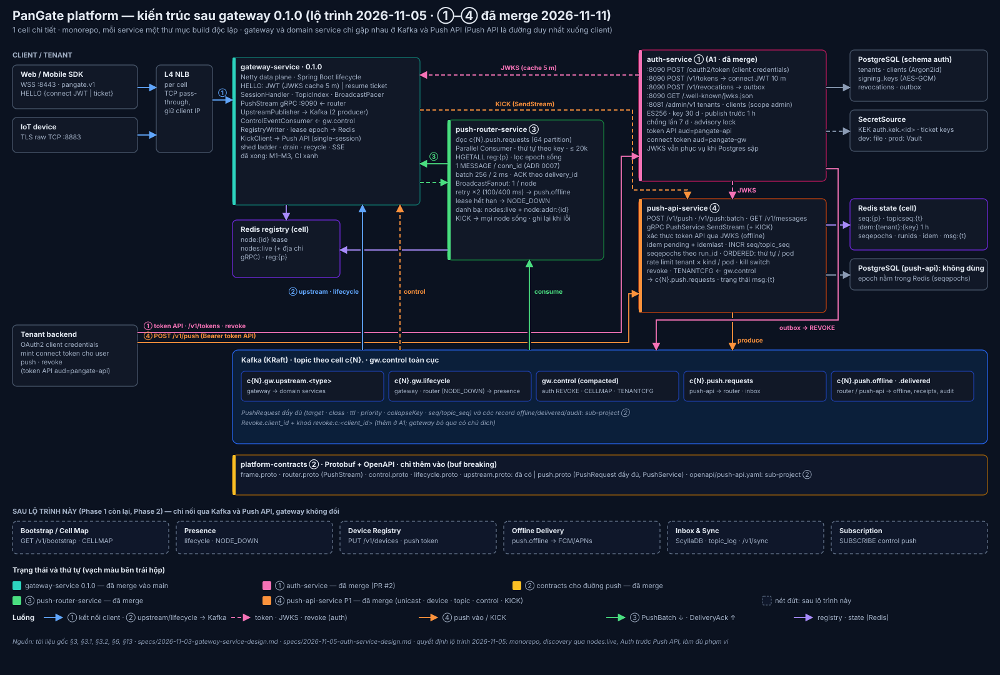

# Contracts cho đường push — Design Spec

- **Ngày:** 2026-11-10
- **Trạng thái:** Đã hiện thực (milestone C1, plan `docs/superpowers/plans/2026-11-10-push-contracts-c1.md`, 2026-11-10). Số đo: `make verify` xanh (contracts 15, testkit 24 + 6 IT trên Kafka thật, gateway 580 + 97 IT, auth 79 + 39 IT); `buf lint` / `buf breaking` xanh; devenv tạo `c1.push.requests` 64 / `offline` 16 / `delivered` 16 partition; `make smoke` xanh (push → ack 473 ms, revoke → 4003 598 ms)
- **Nguồn kiến trúc:** *Netty Gateway — 10M Active Connections* (gọi tắt là "tài liệu gốc"); số mục trong ngoặc, ví dụ (§3.5), là mục của tài liệu gốc. "Spec gateway" là `docs/superpowers/specs/2026-11-03-gateway-service-design.md`; "spec auth" là `docs/superpowers/specs/2026-11-05-auth-service-design.md`.
- **Vị trí trong lộ trình:** sub-project 2/4 sau `0.1.0`: (1) `auth-service` (xong, A1), **(2) contracts cho đường push**, (3) `push-router-service`, (4) `push-api-service`.



---

## 0. Mục tiêu, tiêu chí thành công, phạm vi

**Mục tiêu.** Chốt contract cho đường Push API → Kafka → Push Router → gateway để ③ và ④ hiện thực song song mà không phải sửa contract. Gồm:
- message Protobuf và quy ước Kafka;
- phần mở rộng `PushService`;
- định dạng value của registry;
- một bộ contract-test dùng chung.

**Tiêu chí thành công của spec.** Người hiện thực ③ và ④ không phải đoán về field, key, header, topic, luật hợp lệ hay định dạng registry.

**Quyết định đã chốt khi brainstorm (2026-11-10):**

| # | Câu hỏi | Quyết định |
|---|---|---|
| C1 | Sub-project giao ra gì | `.proto` + quy ước + bộ contract-test dùng chung (module testkit); không có service |
| C2 | Target device phân giải ở đâu | Ở router: gateway ghi thêm `device` vào value `reg:{p}` |
| C3 | Ngữ nghĩa topic push Phase 1 | Mọi topic push là một `BROADCAST` cho mỗi node; RELIABLE/ORDERED có `topic_seq`; fan-out theo thành viên để Phase 2 |
| C4 | Ai dựng `Frame` | Push API dựng `Frame` hoàn chỉnh; router chỉ bọc vào `PushItem` |
| C5 | API gRPC nội bộ của Push API | Mở rộng additive `PushService.SendStream` |
| C6 | Testkit đặt ở đâu | Module mới `platform-contracts-testkit` |
| C7 | Hình dạng trên Kafka | Một envelope `PushRecord` trên một topic `cN.push.requests` (như §6 tài liệu gốc) |

**Ngoài phạm vi:**
- code của router (③) và Push API (④);
- fan-out-on-write theo thành viên;
- Inbox và `topic_log`;
- schema HTTP chi tiết của `POST /v1/push` (thuộc ④; spec này chỉ cố định ánh xạ field);
- Schema Registry (§3.4: không dùng trong v1).

**Bất biến:**
1. **Push API là đường xuống duy nhất** (§3.2). Chỉ Push API produce vào `cN.push.requests`.
2. **Chỉ thay đổi additive.** `buf breaking` xanh, và gateway 0.1.0 tiếp tục chạy mà không cần sửa.
3. **Thứ tự theo principal được giữ.** MESSAGE và CONTROL của một principal dùng cùng key, nên nằm cùng partition.

---

## 1. Message mới (`platform-contracts/proto/pangate/v1/push_record.proto`)

```protobuf
syntax = "proto3";
package pangate.v1;

import "pangate/v1/control.proto";  // DeviceRef
import "pangate/v1/frame.proto";    // Frame, DeliveryClass
import "pangate/v1/router.proto";   // PushItem.Priority, ControlOp, AckItem.Status

option java_package = "com.pangate.contracts.v1";
option java_multiple_files = true;

// cN.push.requests — produced only by Push API; consumed by the router (group "push-router") and, in Phase 2, the inbox.
message PushRecord {
  enum Kind { KIND_UNSPECIFIED = 0; KIND_MESSAGE = 1; KIND_BROADCAST = 2; KIND_CONTROL = 3; }
  string msg_id = 1;                 // ULID; every consumer dedups on it
  Kind kind = 2;
  string tenant_id = 3;
  string cell_id = 4;
  oneof target {
    string principal_id = 5;         // MESSAGE to every session of the principal, or CONTROL
    DeviceRef device = 6;            // MESSAGE to one device (principal_id + device_id)
    string topic = 7;                // BROADCAST
  }
  DeliveryClass class = 8;
  PushItem.Priority priority = 9;
  int64 accepted_at_ms = 10;
  int64 expires_at_ms = 11;          // accepted_at_ms + ttl; past it the router does not deliver (see §1.1)
  string collapse_key = 12;
  bool receipt = 13;                 // the router produces a DeliveredRecord on delivery
  string sender_principal_id = 14;   // key of cN.push.delivered; empty for system pushes
  Frame frame = 15;                  // MESSAGE / BROADCAST: a complete PUSH frame (msg_id, class, payload, headers,
                                     //   seq/seq_epoch for MESSAGE, topic/topic_seq for BROADCAST)
  ControlOp control = 16;            // CONTROL: SUBSCRIBE / UNSUBSCRIBE / KICK / REFRESH_CONFIG
}

// cN.push.offline — router → Offline Delivery. Only for RELIABLE / ORDERED MESSAGE records.
message OfflineRecord {
  enum Reason {
    REASON_UNSPECIFIED = 0;
    REASON_NO_SESSION = 1;           // no live registry entry (or no entry for the target device)
    REASON_NACK_TIMEOUT = 2;         // no ack after the retries (§3.5: 5 s, 2 retries)
    REASON_NODE_GONE = 3;            // node lease lost while in flight
    REASON_SLOW_CONSUMER = 4;
    REASON_OVERFLOW = 5;
    REASON_CLOSED = 6;
    REASON_SHED = 7;
    REASON_EXPIRED = 8;              // expires_at_ms passed before delivery
  }
  PushRecord record = 1;             // unchanged
  Reason reason = 2;
  uint32 attempts = 3;
  int64 at_ms = 4;
}

// cN.push.delivered — router → Receipts, only when record.receipt is true.
message DeliveredRecord {
  string msg_id = 1;
  string tenant_id = 2;
  string sender_principal_id = 3;
  string principal_id = 4;
  string device_id = 5;
  string conn_id = 6;
  AckItem.Status status = 7;         // STATUS_ACKED (RELIABLE / ORDERED) or STATUS_WRITTEN (EPHEMERAL)
  int64 at_ms = 8;
}
```

### 1.1 Ngữ nghĩa các trường

| Trường | Luật |
|---|---|
| `kind` ↔ `target` | MESSAGE: `principal_id` hoặc `device`. BROADCAST: `topic`. CONTROL: `principal_id` |
| `frame` | Có với MESSAGE và BROADCAST, không có với CONTROL. `frame.type = FRAME_TYPE_PUSH`, `frame.msg_id = msg_id`, `frame.class = class` |
| `frame.seq`, `seq_epoch` | Chỉ có với MESSAGE RELIABLE/ORDERED tới **principal** (do Push API cấp, §3.3). MESSAGE tới **device** không bao giờ có `seq` (một device-push không được tiêu `seq` của principal mà các device khác không nhận, vì như thế các device đó thấy gap giả) và không được là ORDERED (V11) |
| `frame.topic`, `topic_seq` | `frame.topic = topic` với BROADCAST. `topic_seq` chỉ có với BROADCAST RELIABLE/ORDERED (quyết định C3) |
| `expires_at_ms` | Router không giao record đã quá hạn: RELIABLE/ORDERED MESSAGE chuyển sang `push.offline` với `REASON_EXPIRED`; còn lại thì bỏ, có metric |
| EPHEMERAL | Không bao giờ vào `push.offline`; miss thì bỏ, có metric (§3.5) |
| BROADCAST và CONTROL | Không vào `push.offline`; không có `DeliveredRecord` |
| `receipt` | Chỉ cho MESSAGE RELIABLE/ORDERED (V10: EPHEMERAL hay BROADCAST kèm `receipt` bị từ chối, vì gateway không ack EPHEMERAL). Mỗi kết nối trả `AckItem` `STATUS_ACKED` hoặc `STATUS_WRITTEN` (giao không cần client ack: phiên SSE, kill switch `delivery.downgradeReliable`) sinh một `DeliveredRecord` với đúng status đó |

### 1.1a Kết quả giao của router (router ③ thực thi)

**Phạm vi.** MESSAGE tới principal được fan-out tới mọi kết nối còn sống của principal (mỗi kết nối một `PushItem` với `conn_id`). MESSAGE tới device chỉ gửi tới kết nối của device đó.

**Một record đã "giao"** khi ít nhất một kết nối trả `STATUS_ACKED` hoặc `STATUS_WRITTEN`. Kết nối nào thất bại thì device đó bù lại qua sync (Inbox, Phase 2), không qua `push.offline`, để Offline Delivery không đẩy lại cho device đã nhận.

**Một record "offline"** (chỉ RELIABLE/ORDERED MESSAGE): khi không kết nối nào giao được sau các retry dưới đây. Mỗi record sinh đúng một `OfflineRecord`, với `reason` là lý do của lần thử cuối.

**Bảng xử lý từng `AckItem.Status`:**

| `AckItem.Status` | Retry? | Khi hết cách |
|---|---|---|
| `STATUS_ACKED`, `STATUS_WRITTEN` | — | Kết nối đó đã giao |
| `STATUS_NACK_TIMEOUT` | Có: tra lại registry và gửi lại sau 100 ms, rồi sau 400 ms (2 retry, §3.5 tài liệu gốc). Gửi lại thì dùng `delivery_id` mới; gateway bỏ qua `msg_id` đã có trong window, nên không có bản trùng trên cùng một kết nối | `REASON_NACK_TIMEOUT` |
| `STATUS_NACK_CLOSED`, `STATUS_NACK_NOT_FOUND` | Có: tra lại registry (phiên có thể đã chuyển node) rồi gửi lại, tối đa 2 lần | `REASON_CLOSED`; không còn entry sống thì `REASON_NO_SESSION` |
| `STATUS_NACK_OVERFLOW`, `STATUS_NACK_SLOW_CONSUMER`, `STATUS_NACK_SHED` | Không (gateway đang quá tải hoặc client không đọc) | `REASON_OVERFLOW`, `REASON_SLOW_CONSUMER`, `REASON_SHED` |
| Lease node mất trong lúc chờ ack | Như `NACK_CLOSED` | `REASON_NODE_GONE` |
| Không có entry sống ngay từ đầu | — | `REASON_NO_SESSION` |
| `now > expires_at_ms` trước khi gửi | — | `REASON_EXPIRED` |

**`attempts`:** số `PushItem` router đã gửi cho record đó, tính cả mọi kết nối và mọi retry. Bằng 0 với `REASON_NO_SESSION` / `REASON_EXPIRED` khi chưa gửi lần nào.

**Các trường hợp còn lại:**
- EPHEMERAL được coi là đã giao khi đã ghi vào stream tới node (gateway không ack EPHEMERAL); không có retry, offline hay receipt.
- BROADCAST và CONTROL: gửi một lần tới mỗi node có liên quan, không có offline hay receipt.

**Thứ tự.** Thứ tự chỉ được giữ giữa MESSAGE và CONTROL của **cùng một principal** (cùng key). BROADCAST (key `topic:<t>`) không có thứ tự so với CONTROL (ví dụ SUBSCRIBE) hay MESSAGE.

### 1.2 `lifecycle.proto` (additive)

- `ConnectionEvent.event_id = 13`: ULID; consumer dedup theo trường này.
- `EVENT_TYPE_NODE_DOWN = 5`:
  - Router phát khi lease `node:{id}` hết hạn (§3.5).
  - Chỉ có `node_id`, `epoch`, `cell_id`, `at_ms` và `event_id`.
  - Mọi router đều phát, nên consumer dedup theo `node_id:epoch`.

### 1.3 `push.proto` (additive), xem §3

---

## 2. Quy ước Kafka

| Topic | Key | Partitions | Retention | Producer → consumer |
|---|---|---|---|---|
| `cN.push.requests` | MESSAGE/CONTROL: `principal_id`; device target: `device.principal_id`; BROADCAST: `topic:<topic>` | 64 | 24 h, delete | Push API → router (group `push-router`), inbox (Phase 2) |
| `cN.push.offline` | `record` principal (như trên) | 16 | 7 d, delete | router → Offline Delivery |
| `cN.push.delivered` | `sender_principal_id` (rỗng thì dùng `msg_id`) | 16 | 24 h, delete | router → Receipts |
| `cN.gw.lifecycle` (đã có) | `principal_id`; `node_id` cho `NODE_DOWN` | 32 | 24 h, delete | gateway, router → presence, … |

- **Producer:** idempotent, `acks=all`, `compression.type=zstd`. Push API dùng `linger.ms` 1–2 (§3.4).
- **Header:** mọi record ghi bằng `PangateHeaders.write`:
  - `traceparent`, nếu có;
  - `tenant-id`;
  - `cell-id`;
  - `content-type: application/x-protobuf; schema=pangate.v1.<PushRecord|OfflineRecord|DeliveredRecord|ConnectionEvent>`.
- **Giới hạn:** `frame.payload` ≤ 64 KB, do Push API thực thi; record tối đa khoảng 70 KB.
- **Consumer:** at-least-once, dedup theo `msg_id` hoặc `event_id`.
- **Devenv:** `kafka-init` tạo `c1.push.requests` (64), `c1.push.offline` (16) và `c1.push.delivered` (16), cạnh các topic `c1.gw.*` đã có.

---

## 3. `PushService.SendStream` (mở rộng additive `push.proto`)

```protobuf
message PushRequest {
  enum Kind { KIND_UNSPECIFIED = 0; KIND_CONTROL = 1; KIND_MESSAGE = 2; KIND_BROADCAST = 3; }
  string request_id = 1;            // echoed in PushResponse; responses may arrive out of order
  Kind kind = 2;
  string tenant_id = 3;
  string principal_id = 4;          // MESSAGE / CONTROL
  pangate.v1.ControlOp control = 5; // CONTROL
  string device_id = 6;             // MESSAGE: set = one device of principal_id
  string topic = 7;                 // BROADCAST
  DeliveryClass class = 8;          // UNSPECIFIED = RELIABLE
  PushItem.Priority priority = 9;   // UNSPECIFIED = NORMAL
  uint32 ttl_sec = 10;              // 0 = 86400; at most 604800
  string collapse_key = 11;
  bool receipt = 12;
  string idempotency_key = 13;      // dedup 1 h per tenant; empty = no dedup
  bytes payload = 14;               // ≤ 64 KB, opaque to the platform
  map<string, string> headers = 15; // copied into Frame.headers (type, content-type, traceparent)
  string sender_principal_id = 16;
}

message PushResponse {
  enum Code {
    CODE_UNSPECIFIED = 0; CODE_OK = 1; CODE_INVALID = 2; CODE_FORBIDDEN = 3;
    CODE_RATE_LIMITED = 4; CODE_QUOTA_EXCEEDED = 5; CODE_UNAVAILABLE = 6;
  }
  string request_id = 1;
  bool ok = 2;                      // kept for 0.1.0 callers: ok == (code == CODE_OK)
  string error = 3;                 // kept: human-readable detail, never secrets
  Code code = 4;
  string msg_id = 5;
  uint64 seq = 6;
  uint32 seq_epoch = 7;
  uint64 topic_seq = 8;
  string cell_id = 9;
  bool duplicate = 10;              // idempotency hit: msg_id/seq/topic_seq are those of the first request
  uint32 retry_after_ms = 11;       // RATE_LIMITED / UNAVAILABLE
}
```

### 3.1 Luật hợp lệ (④ thực thi; testkit có ca kiểm thử cho từng luật)

| # | Luật | Vi phạm |
|---|---|---|
| V1 | `kind` khác `KIND_UNSPECIFIED` | `CODE_INVALID` |
| V2 | MESSAGE: có `principal_id` và `payload`; không có `topic` và `control` | `CODE_INVALID` |
| V3 | BROADCAST: có `topic` và `payload`; không có `principal_id`, `device_id` và `control` | `CODE_INVALID` |
| V4 | CONTROL: có `principal_id` và `control` (op đã được set); không có `payload` và `topic` | `CODE_INVALID` |
| V5 | `principal_id` và `topic` bắt đầu bằng `<tenant_id>:`; `principal_id` ≤ 256 B; `topic` ≤ 256 B | `CODE_INVALID` |
| V6 | `device_id` dài 1..128 B, không chứa `/` | `CODE_INVALID` |
| V7 | `payload` ≤ 65 536 B; `ttl_sec` ≤ 604 800 | `CODE_INVALID` |
| V8 | `tenant_id` không rỗng, không phải `__warmup` | `CODE_INVALID` |
| V9 | Request KICK 5-field của gateway 0.1.0 (CONTROL + `control.kick`) hợp lệ | — (phải `CODE_OK`) |
| V10 | `receipt` chỉ cho MESSAGE RELIABLE/ORDERED | `CODE_INVALID` |
| V11 | MESSAGE tới device (`device_id` có giá trị) không được là ORDERED | `CODE_INVALID` |

Quyền của bên gọi: với gRPC nội bộ thì kiểm theo allowlist mTLS, với HTTP thì theo scope `push:send` / `push:broadcast`. Vi phạm trả `CODE_FORBIDDEN`. Đây là việc của ④; spec này chỉ cố định mã lỗi.

### 3.3 State dùng chung với gateway và idempotency

Gateway đọc state mà Push API ghi (spec gateway §6.7, §14.1). Contract này chốt điều đó; `SeqKeys` trong testkit là bản tham chiếu và gateway có test đối chiếu.

| State | Định dạng | Ai ghi / ai đọc |
|---|---|---|
| `seq:{<principal>}` (Redis state) | Số thập phân, `INCR` một lần cho mỗi MESSAGE RELIABLE/ORDERED tới **principal**; chưa có key = 0 | Push API ghi; gateway `GET` khi HELLO để điền `CONNECTED.seq` |
| `seqepochs` (hash, Redis state) | field là slot (thập phân 0..16383), value là `seqEpoch` (thập phân); slot không có = 0. Slot = slot Redis Cluster của chuỗi principal (CRC16-XMODEM mod 16384, có tôn trọng hash tag), như `SlotHash.getSlot` của Lettuce | Push API ghi khi bump epoch sau failover; gateway `HGETALL` mỗi 5 s |
| `topicseq:{<topic>}` (Redis state) | Như `seq:{p}`, cho mỗi BROADCAST RELIABLE/ORDERED | Chỉ Push API |
| Idempotency `idem:{<tenant>}:{<idempotency_key>}` | Lưu `PushResponse` đầu tiên, TTL 1 h. Request trùng key trong cùng tenant trả **đúng response đó** với `duplicate = true` và `CODE_OK`, không produce lần nữa. **Không** so sánh body: cùng key với body khác vẫn là duplicate | Chỉ Push API |

### 3.2 Ánh xạ sang `POST /v1/push` (④)

| JSON (§3.2 tài liệu gốc) | `PushRequest` |
|---|---|
| `target.type = principal`, `target.id` | `kind = MESSAGE`, `principal_id` |
| `target.type = device`, `target.principal`, `target.id` | `kind = MESSAGE`, `principal_id`, `device_id` |
| `target.type = topic`, `target.id` | `kind = BROADCAST`, `topic` |
| `class`, `ttlSec`, `priority`, `collapseKey`, `receipt` | `class`, `ttl_sec`, `priority`, `collapse_key`, `receipt` |
| header `Idempotency-Key` | `idempotency_key` |
| `payload.type` | `headers["type"]` |
| `payload` (JSON) | `payload` (UTF-8 JSON), `headers["content-type"] = application/json` |
| tenant của token API | `tenant_id` (không bao giờ lấy từ body) |
| `202 {msgId, seq, cell}` | `msg_id`, `seq`, `cell_id` (cộng `seqEpoch`, `topicSeq` nếu có) |
| `400` / `403` / `429` / `503` | `CODE_INVALID` / `CODE_FORBIDDEN` / `CODE_RATE_LIMITED` hoặc `CODE_QUOTA_EXCEEDED` / `CODE_UNAVAILABLE` |

---

## 4. Value của registry (`reg:{principal}`) — v2

- **Định dạng.** Field là `connId`. Value v2 là `nodeId|epoch|connectedAtMs|platform|device`. `device` đứng cuối và có thể chứa `|`, nên phía đọc tách với giới hạn 5: `split("\\|", 5)`.
- **Ngữ pháp.**
  - `nodeId` và `platform` không chứa `|`.
  - `epoch` và `connectedAtMs` là số thập phân không âm.
  - `platform` có thể rỗng.
  - `device` có thể rỗng; v2 với device rỗng thì không khớp target device nào.
- **v1 (gateway 0.1.0).** Value v1 là `nodeId|epoch|connectedAtMs|platform`, tức 4 phần. Phía đọc chấp nhận và coi device là "không biết"; entry v1 không bao giờ khớp target device. Rolling deploy drain mọi phiên, nên entry v1 biến mất sau một lượt deploy gateway.
- **Value hỏng.** Ít hơn 4 phần, hoặc số không parse được: phía đọc bỏ qua entry và đếm metric. Router không được ngã vì một value hỏng.
- **Gateway.** `RegistryWriter` ghi v2. Không đổi gì khác trong Lua và khoá.

---

## 5. Thay đổi ở gateway

| Nơi | Thay đổi |
|---|---|
| `registry/RegistryWriter` | Ghi value v2 (§4) với `device` của phiên |
| `upstream/LifecyclePublisher` | Gán `event_id` (ULID) cho mọi `ConnectionEvent`; gateway không phát `NODE_DOWN` |
| Test | `RegistryValueV2Test` khớp golden v2 của testkit; test lifecycle kiểm tra `event_id` là ULID và không trùng. Không sửa test cũ, **trừ** những assertion đang chốt đúng chuỗi value v1 (`RegistryWriterIT`, `GatewayClusterIT`): chúng chuyển sang v2 mà vẫn so đúng từng ký tự |
| `platform` | `RegistryWriter` thay `|` trong `platform` (do client gửi) bằng `_`, để `device` không bị lệch phần |
| Không đổi | `PushStream`, `PushItem`, `AckItem`, đường KICK qua `PushService` (5 field cũ), `ControlKeys` |

Gateway có thể lên trước router, vì router ③ đọc được cả v1 lẫn v2.

---

## 6. `platform-contracts-testkit`

Module mới, build sau `platform-contracts` và `platform-spring-starter` (testkit dùng `PangateHeaders` của starter).
- **Toạ độ:** `com.pangate:platform-contracts-testkit:0.1.0`, package `com.pangate.contracts.testkit`.
- **Parent:** `platform-parent`.
- **Phụ thuộc:** `platform-contracts`, `kafka-clients`, `org.testcontainers:kafka`, `junit-jupiter-api`, `assertj-core`, tất cả ở scope compile của module. Không phụ thuộc Spring.
- **Bên dùng:** ③, ④ và gateway khai báo testkit ở scope `test`.

| Lớp hoặc tài nguyên | API |
|---|---|
| `PushTopics` | `requests(cell)`, `offline(cell)`, `delivered(cell)`, `lifecycle(cell)` → tên topic; `partitions(name)`, `retention(name)` theo §2 |
| `PushKeys` | `of(PushRecord)`, `of(OfflineRecord)`, `of(DeliveredRecord)`, `of(ConnectionEvent)` theo §2 |
| `PushHeaders` | `write(Headers, tenant, cell, traceparent, messageName)` (bọc `PangateHeaders`); `assertConventions(ConsumerRecord<String, byte[]>, String messageName)` |
| `Fixtures` | `message(principal)`, `deviceMessage(principal, device)`, `broadcast(topic)`, `control(principal, ControlOp)`, `offline(record, reason)`, `delivered(record, connId)`, `nodeDown(nodeId, epoch)`; mặc định hợp lệ theo §1.1, sửa được qua `toBuilder()` |
| `PushRequestCases` | `List<Case(String name, PushRequest request, PushResponse.Code expected)>`, ít nhất một ca đúng và một ca sai cho mỗi luật V1–V11 |
| `PushRecordRules` | `assertValid(PushRecord)`: mọi luật §1.1, ném `AssertionError` nêu tên luật. `PushPathScenario.produce` gọi nó; ④ dùng để kiểm record mình produce |
| `SeqKeys` | `seq(principal)`, `SEQ_EPOCHS`, `slot(principal)` theo §3.3 |
| `RegistryValues` | `List<Case(String value, Optional<Parsed> expected)>`, với `Parsed(nodeId, epoch, connectedAtMs, platform, Optional<String> device)`: v1, v2, device chứa `|`, device rỗng, thiếu phần, số hỏng; và `v2(nodeId, epoch, connectedAtMs, platform, device)` để dựng chuỗi chuẩn |
| `golden/v1/<name>.textproto`, `<name>.bin` | Một cặp cho mỗi fixture của `Fixtures` và một request mẫu cho mỗi `kind` của `PushRequest` |
| `PushPathScenario` | Extension JUnit 5 quản lý một `KafkaContainer` dùng chung trong JVM và tạo topic theo `PushTopics`. API: `bootstrapServers()`, `produce(PushRecord)` (đúng key và header), `awaitRequest(msgId)`, `awaitOffline(msgId, Reason)`, `awaitDelivered(msgId)`, `awaitNodeDown(nodeId, epoch)`, `drain(topic)`; mọi record đọc ra đều qua `assertConventions` |

**Ai dùng thế nào:**
- **③** produce bằng `PushPathScenario`, chạy router thật trong test, rồi đợi `push.offline`, `push.delivered` và `NODE_DOWN`. Parser registry của ③ chạy hết `RegistryValues`.
- **④** chạy `PushRequestCases` trên gRPC thật, rồi `awaitRequest(msgId)` và so record với các luật §1.1.
- **Gateway** so value registry nó ghi với `RegistryValues.v2(...)`.

---

## 7. Kiểm thử

| Mức | Nội dung tối thiểu |
|---|---|
| Contract | `buf lint`; `buf breaking --against '.git#branch=main,subdir=platform-contracts'` |
| Testkit, unit | Golden: `encode(fixture)` trùng byte của `.bin`, và textproto parse ra đúng fixture; `PushKeys` cho bốn loại target; `RegistryValues` (parser tham chiếu trong testkit chạy hết các ca); `PushRequestCases` có đủ ca đúng và sai cho mỗi luật; `Fixtures` thoả §1.1 |
| Testkit, IT (Kafka thật) | `PushPathScenario` với một router giả ở scope test của testkit: produce MESSAGE → router giả ghi `OfflineRecord` → `awaitOffline` đọc được đúng key, header và record; năm MESSAGE của một principal ra đúng thứ tự; BROADCAST đi theo key `topic:<t>` |
| Gateway | `RegistryWriter` khớp golden v2; `event_id` của lifecycle là ULID và không trùng trong 10 000 sự kiện; toàn bộ unit, IT, `make smoke` và `make local-check` cũ vẫn xanh |

---

## 8. Thay đổi ngoài `platform-contracts`

| Nơi | Thay đổi |
|---|---|
| `platform-contracts-testkit/` | Module mới (§6) |
| `gateway-service` | §5; `pom.xml` thêm testkit ở scope `test` |
| `Makefile` | `MODULES` thêm `platform-contracts-testkit` sau `platform-spring-starter` |
| `platform-devenv/docker-compose.yml` | `kafka-init` tạo `c1.push.requests`, `c1.push.offline`, `c1.push.delivered` |
| `platform-devenv/scripts/release-check.sh` | Kiểm version của testkit |
| `docs/adr/` | ADR 0016–0018 (§9) |

---

## 9. ADR mới

| ADR | Quyết định |
|---|---|
| 0016 | Một envelope `PushRecord` trên `cN.push.requests`; key là principal (cả với target device) hoặc `topic:<t>` |
| 0017 | Push API dựng sẵn `Frame`; router không đọc payload |
| 0018 | Value registry v2 có device ở cuối; router phân giải target device; v1 được chấp nhận và không bao giờ khớp target device |

---

## 10. Milestone C1 và tiêu chí hoàn thành

1. `buf lint` và `buf breaking` xanh với `push_record.proto`, `lifecycle.proto` và `push.proto` đúng §1–§3.
2. `platform-contracts-testkit` 0.1.0 build được; unit và IT của nó xanh.
3. Gateway ghi registry v2 và gán `event_id`; mọi test cũ, `make smoke` và `make local-check` xanh. Test cũ chỉ được sửa ở những assertion chốt đúng chuỗi value v1 (§5).
4. `make up` tạo đủ các topic `c1.push.*`.
5. Spec có bảng ánh xạ §3.2; ③ và ④ có thể bắt đầu mà không phải hỏi thêm về contract.
6. ADR 0016–0018 đã viết; `make release-check` xanh; CI xanh.

---

## 11. Câu hỏi còn mở

1. `cN.push.delivered` có cần thêm field `read` khi Receipts (Phase 2) gộp `gw.upstream.read` không? Hiện chưa cần; nếu cần, thêm additive.
2. Số partition 64/16/16 lấy từ §3.4 cho production. Devenv dùng cùng số đó, chưa đo chi phí của chúng trên máy dev.
